# Config switch effects

Generated by `scripts/config-switch-evidence.py --docs` (48/48 switches captured).

Each switch has an off/on GIF: the first frames show the cluster's logs with the switch **off**, the last frames with it **on**. The evidence is the owning app's `[Config]` echo (proving the switch was applied) plus the behavioural lines that appear in exactly one state while the standard exercise (login, entity create, cell switch, settle) runs. Timestamps, pids and ports are normalised so the two states are comparable; a switch whose effect the exercise does not trigger says so rather than inventing one.

Rerunnable: `config-switch-evidence.py` (resumable, switches already captured are skipped unless `--force`) then `--docs`.

| switch | xml path | default | apps with a difference |
|---|---|---|---|
| `BalanceConfig.demo` | `balance/demo/enable` | false | 3 |
| `BaseAppConfig.backUpUndefinedProperties` | `baseApp/backUpUndefinedProperties` | false | 2 |
| `BaseAppConfig.sendAuthToClient` | `baseApp/sendAuthToClient` | false | 2 |
| `BaseAppConfig.shouldDelayLookUpSend` | `baseApp/shouldDelayLookUpSend` | false | 3 |
| `BaseAppConfig.shouldLogBackups` | `baseApp/shouldLogBackups` | false | 2 |
| `BaseAppConfig.shouldResolveMailBoxes` | `baseApp/shouldResolveMailBoxes` | false | 5 |
| `BaseAppConfig.shouldShutDownIfPortUsed` | `baseApp/shouldShutDownIfPortUsed` | true | 6 |
| `BaseAppConfig.verboseExternalInterface` | `baseApp/verboseExternalInterface` | false | 3 |
| `BaseAppConfig.warnOnNoDef` | `baseApp/warnOnNoDef` | true | 3 |
| `BotsConfig.shouldListenForGeometryMappings` | `bots/shouldListenForGeometryMappings` | false | 1 |
| `BotsConfig.shouldUseRandomName` | `bots/shouldUseRandomName` | true | 0 |
| `BotsConfig.shouldUseScripts` | `bots/shouldUseScripts` | true | 2 |
| `BotsConfig.shouldUseTCP` | `bots/shouldUseTCP` | false | 3 |
| `BotsConfig.shouldUseWebSockets` | `bots/shouldUseWebSockets` | false | 1 |
| `CellAppConfig.enforceGhostDecorators` | `cellApp/enforceGhostDecorators` | true | 3 |
| `CellAppConfig.fastShutdown` | `cellApp/fastShutdown` | true | 3 |
| `CellAppConfig.loadDominantTextureMaps` | `cellApp/loadDominantTextureMaps` | false | 4 |
| `CellAppConfig.sendDetailedPlayerVehicles` | `cellApp/sendDetailedPlayerVehicles` | false | 1 |
| `CellAppConfig.shouldNavigationDropPosition` | `cellApp/shouldNavigationDropPosition` | false | 3 |
| `CellAppConfig.shouldResolveMailBoxes` | `cellApp/shouldResolveMailBoxes` | false | 4 |
| `CellAppConfig.treatAllOtherEntitiesAsGhosts` | `cellApp/treatAllOtherEntitiesAsGhosts` | true | 2 |
| `CellAppMgrConfig.shouldArchiveSpaceData` | `cellAppMgr/shouldArchiveSpaceData` | true | 1 |
| `CellAppMgrConfig.shouldLimitBalanceToChunks` | `cellAppMgr/shouldLimitBalanceToChunks` | true | 3 |
| `CellAppMgrConfig.shouldMetaLoadBalance` | `cellAppMgr/shouldMetaLoadBalance` | (getter) | 3 |
| `CellAppMgrConfig.shouldShowMetaLoadBalanceDebug` | `cellAppMgr/shouldShowMetaLoadBalanceDebug` | false | 3 |
| `DBAppConfig.shouldCacheLogOnRecords` | `dbApp/shouldCacheLogOnRecords` | false | 2 |
| `DBAppConfig.shouldDelayLookUpSend` | `dbApp/shouldDelayLookUpSend` | false | 3 |
| `LoginAppConfig.allowLogin` | `loginApp/allowLogin` | false | 7 |
| `LoginAppConfig.allowProbe` | `loginApp/allowProbe` | false | 7 |
| `LoginAppConfig.allowUnencryptedLogins` | `loginApp/allowUnencryptedLogins` | false | 7 |
| `LoginAppConfig.logProbes` | `loginApp/logProbes` | true | 7 |
| `LoginAppConfig.passwordlessLoginsOnly` | `loginApp/passwordlessLoginsOnly` | false | 5 |
| `LoginAppConfig.registerExternalInterface` | `loginApp/registerExternalInterface` | false | 7 |
| `LoginAppConfig.shouldOffsetExternalPortByUID` | `loginApp/shouldOffsetExternalPortByUID` | false | 9 |
| `LoginAppConfig.shouldShutDownIfPortUsed` | `loginApp/shouldShutDownIfPortUsed` | true | 4 |
| `LoginAppConfig.verboseExternalInterface` | `loginApp/verboseExternalInterface` | false | 3 |
| `LoginAppConfig.verboseLoginFailures` | `loginApp/verboseLoginFailures` | false | 1 |
| `ManagerAppConfig.isBadStateWithNoServiceApps` | `isBadStateWithNoServiceApps` | false | 2 |
| `ManagerAppConfig.shutDownServerOnBadState` | `shutDownServerOnBadState` | true | 2 |
| `ManagerAppConfig.shutDownServerOnBaseAppDeath` | `shutDownServerOnBaseAppDeath` | false | 3 |
| `ManagerAppConfig.shutDownServerOnCellAppDeath` | `shutDownServerOnCellAppDeath` | false | 2 |
| `ManagerAppConfig.shutDownServerOnServiceAppDeath` | `shutDownServerOnServiceAppDeath` | false | 3 |
| `ManagerAppConfig.shutDownServerOnServiceDeath` | `shutDownServerOnServiceDeath` | false | 3 |
| `ReviverConfig.shutDownOnRevive` | `reviver/shutDownOnRevive` | true | 1 |
| `ServerAppConfig.allowInteractiveDebugging` | `allowInteractiveDebugging` | (getter) | 8 |
| `ServerAppConfig.hasHitchDetection` | `hitchDetection/enabled` | false | 9 |
| `ServerAppConfig.isProduction` | `production` | true | 8 |
| `ServerAppConfig.useDefaultSpace` | `useDefaultSpace` | false | 9 |

## BalanceConfig.demo

xml `balance/demo/enable`, default `false` (captured 2026-11-23T02:32:59)

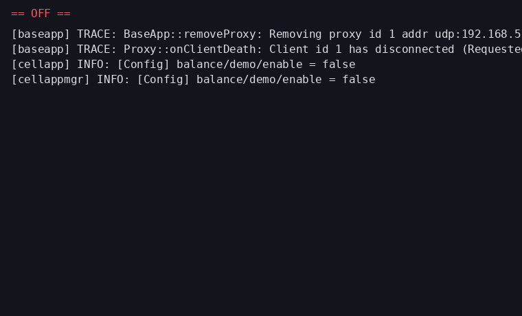

### baseapp

only when **off**:

```
TRACE: BaseApp::removeProxy: Removing proxy id 1 addr udp:192.168.5.188
TRACE: Proxy::onClientDeath: Client id 1 has disconnected (Requested by client)
```

only when **on**:

```
TRACE: BaseApp::removeProxy: Removing proxy id addr udp:192.168.5.188
TRACE: Proxy::onClientDeath: Client id has disconnected (Requested by client)
```

### cellapp

only when **off**:

```
INFO: [Config] balance/demo/enable = false
```

only when **on**:

```
ERROR: [Config] CellApp::init: Production Mode: Demo load balancing enabled!
INFO: [Config] balance/demo/enable = true (default: false)
```

### cellappmgr

only when **off**:

```
INFO: [Config] balance/demo/enable = false
```

only when **on**:

```
INFO: [Config] balance/demo/enable = true (default: false)
```


## BaseAppConfig.backUpUndefinedProperties

xml `baseApp/backUpUndefinedProperties`, default `false` (captured 2026-11-23T02:34:37)

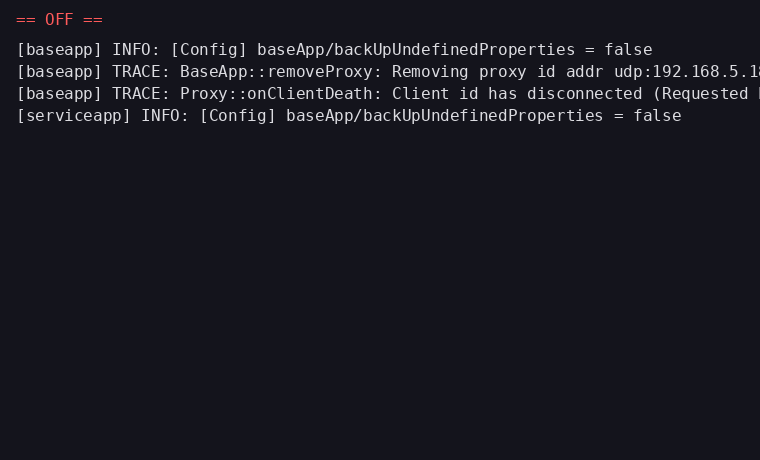

### baseapp

only when **off**:

```
INFO: [Config] baseApp/backUpUndefinedProperties = false
TRACE: BaseApp::removeProxy: Removing proxy id addr udp:192.168.5.188
TRACE: Proxy::onClientDeath: Client id has disconnected (Requested by client)
```

only when **on**:

```
INFO: [Config] baseApp/backUpUndefinedProperties = true (default: false)
TRACE: BaseApp::removeProxy: Removing proxy id 1 addr udp:192.168.5.188
TRACE: Proxy::onClientDeath: Client id 1 has disconnected (Requested by client)
```

### serviceapp

only when **off**:

```
INFO: [Config] baseApp/backUpUndefinedProperties = false
```

only when **on**:

```
INFO: [Config] baseApp/backUpUndefinedProperties = true (default: false)
```


## BaseAppConfig.sendAuthToClient

xml `baseApp/sendAuthToClient`, default `false` (captured 2026-11-23T02:36:15)

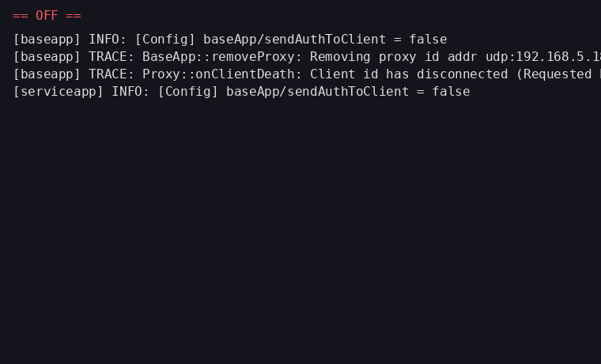

### baseapp

only when **off**:

```
INFO: [Config] baseApp/sendAuthToClient = false
TRACE: BaseApp::removeProxy: Removing proxy id addr udp:192.168.5.188
TRACE: Proxy::onClientDeath: Client id has disconnected (Requested by client)
```

only when **on**:

```
INFO: [Config] baseApp/sendAuthToClient = true (default: false)
TRACE: BaseApp::removeProxy: Removing proxy id 1 addr udp:192.168.5.188
TRACE: Proxy::onClientDeath: Client id 1 has disconnected (Requested by client)
```

### serviceapp

only when **off**:

```
INFO: [Config] baseApp/sendAuthToClient = false
```

only when **on**:

```
INFO: [Config] baseApp/sendAuthToClient = true (default: false)
```


## BaseAppConfig.shouldDelayLookUpSend

xml `baseApp/shouldDelayLookUpSend`, default `false` (captured 2026-11-23T02:37:54)

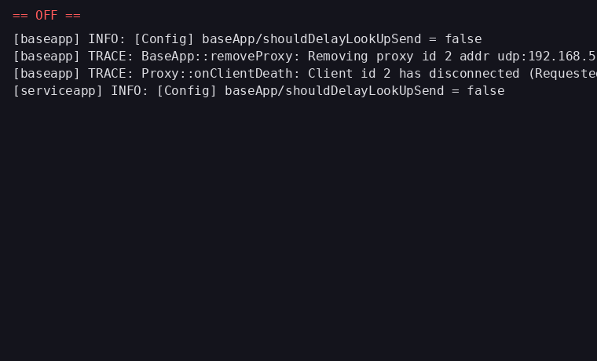

### baseapp

only when **off**:

```
INFO: [Config] baseApp/shouldDelayLookUpSend = false
TRACE: BaseApp::removeProxy: Removing proxy id 2 addr udp:192.168.5.188
TRACE: Proxy::onClientDeath: Client id 2 has disconnected (Requested by client)
```

only when **on**:

```
INFO: [Config] baseApp/shouldDelayLookUpSend = true (default: false)
TRACE: BaseApp::removeProxy: Removing proxy id 1 addr udp:192.168.5.188
TRACE: Proxy::onClientDeath: Client id 1 has disconnected (Requested by client)
```

### cellappmgr

only when **on**:

```
INFO: [Network] CellAppMgr::handleBaseAppMgrBirth: 192.168.5.188
```

### serviceapp

only when **off**:

```
INFO: [Config] baseApp/shouldDelayLookUpSend = false
```

only when **on**:

```
INFO: [Config] baseApp/shouldDelayLookUpSend = true (default: false)
```


## BaseAppConfig.shouldLogBackups

xml `baseApp/shouldLogBackups`, default `false` (captured 2026-11-23T02:39:33)

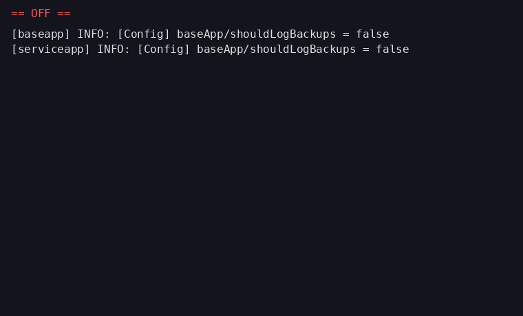

### baseapp

only when **off**:

```
INFO: [Config] baseApp/shouldLogBackups = false
```

only when **on**:

```
DEBUG: BackupSender::autoBackupBase: Base backed up.
INFO: [Config] baseApp/shouldLogBackups = true (default: false)
```

### serviceapp

only when **off**:

```
INFO: [Config] baseApp/shouldLogBackups = false
```

only when **on**:

```
INFO: [Config] baseApp/shouldLogBackups = true (default: false)
```


## BaseAppConfig.shouldResolveMailBoxes

xml `baseApp/shouldResolveMailBoxes`, default `false` (captured 2026-11-23T02:41:13)

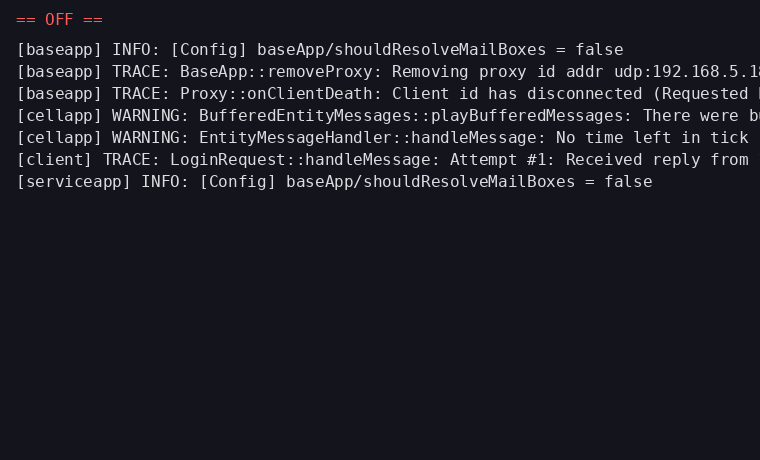

### baseapp

only when **off**:

```
INFO: [Config] baseApp/shouldResolveMailBoxes = false
TRACE: BaseApp::removeProxy: Removing proxy id addr udp:192.168.5.188
TRACE: Proxy::onClientDeath: Client id has disconnected (Requested by client)
```

only when **on**:

```
ERROR: [Network] 1 reports of 'Exception occurred: 192.168.5.188' on 'REASON_NO_SUCH_PORT' in the last 2ms
INFO: [Config] baseApp/shouldResolveMailBoxes = true (default: false)
TRACE: BaseApp::removeProxy: Removing proxy id 1 addr udp:192.168.5.188
TRACE: Proxy::onClientDeath: Client id 1 has disconnected (Requested by client)
```

### cellapp

only when **off**:

```
WARNING: BufferedEntityMessages::playBufferedMessages: There were buffered messages. Played 1 of 1
WARNING: EntityMessageHandler::handleMessage: No time left in tick . Buffering 'createEntityNearEntity' and similar messages this tick. Num previously in buffer = 0.
```

### cellappmgr

only when **on**:

```
INFO: [Network] CellAppMgr::handleBaseAppMgrBirth: 192.168.5.188
```

### client

only when **off**:

```
TRACE: LoginRequest::handleMessage: Attempt #1: Received reply from 192.168.5.188 (after 0.2s)
```

### serviceapp

only when **off**:

```
INFO: [Config] baseApp/shouldResolveMailBoxes = false
```

only when **on**:

```
INFO: [Config] baseApp/shouldResolveMailBoxes = true (default: false)
```


## BaseAppConfig.shouldShutDownIfPortUsed

xml `baseApp/shouldShutDownIfPortUsed`, default `true` (captured 2026-11-23T02:43:02)

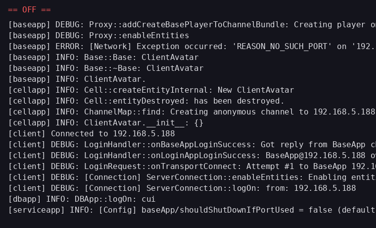

### baseapp

only when **off**:

```
DEBUG: Proxy::addCreateBasePlayerToChannelBundle: Creating player on client
DEBUG: Proxy::enableEntities
ERROR: [Network] Exception occurred: 'REASON_NO_SUCH_PORT' on '192.168.5.188'
INFO: Base::Base: ClientAvatar
INFO: Base::~Base: ClientAvatar
INFO: ClientAvatar.
INFO: ClientAvatar.__init__: {'prop1': 1} 0
INFO: LoginHandler:: from 192.168.5.188. Attempt 1
INFO: [Config] baseApp/shouldShutDownIfPortUsed = false (default: true)
TRACE: BaseApp: at udp:192.168.5.188
TRACE: BaseApp::removeProxy: Removing proxy id 1 addr udp:192.168.5.188
TRACE: Proxy::onClientDeath: Client id 1 has disconnected (Requested by client)
```

only when **on**:

```
INFO: [Config] baseApp/shouldShutDownIfPortUsed = true
```

### cellapp

only when **off**:

```
INFO: Cell::createEntityInternal: New ClientAvatar
INFO: Cell::entityDestroyed: has been destroyed.
INFO: ChannelMap::find: Creating anonymous channel to 192.168.5.188
INFO: ClientAvatar.__init__: {}
```

### client

only when **off**:

```
Connected to 192.168.5.188
DEBUG: LoginHandler::onBaseAppLoginSuccess: Got reply from BaseApp channel udp:192.168.5.188
DEBUG: LoginHandler::onLoginAppLoginSuccess: BaseApp@192.168.5.188 over UDP (# requests: 10, retry interval:1.0s, timeout interval: 8.0s)
DEBUG: LoginRequest::onTransportConnect: Attempt #1 to BaseApp 192.168.5.188; took 0.0s, time left = 8.0s
DEBUG: [Connection] ServerConnection::enableEntities: Enabling entities
DEBUG: [Connection] ServerConnection::logOn: from: 192.168.5.188
DEBUG: [Connection] ServerConnection::logOn: status==LOGGED_ON
DEBUG: [Connection] ServerConnection::logOn: to: 192.168.5.188
TRACE: LoginHandler::sendNextRequest: From 192.168.5.188, attempt #1 / 10 to BaseApp 192.168.5.188
```

only when **on**:

```
INFO: LoginAppLoginRequestProtocol::onReply: Attempt #1: Server rejected our login. Reject status: 78, reject data (optional): At least one CellApp is overloaded.
INFO: [Connection] ServerConnection::logOnComplete: Logon failed: At least one CellApp is overloaded.
Login failed: At least one CellApp is overloaded.
WARNING: LoginHandler::fail: status = 78, errorMessage = "At least one CellApp is overloaded."
```

### dbapp

only when **off**:

```
INFO: DBApp::logOn: cui
```

only when **on**:

```
INFO: DBApp::logOn: Login failed for cui. At least one CellApp is overloaded.
```

### loginapp

only when **on**:

```
DEBUG: DatabaseReplyHandler::handleMessage(192.168.5.188): failure due to overload (status=4e)
INFO: [Network] LoginApp::handleFailure: LogOn for 192.168.5.188 failed, LogOnStatus: 78, description 'At least one CellApp is overloaded.'.
```

### serviceapp

only when **off**:

```
INFO: [Config] baseApp/shouldShutDownIfPortUsed = false (default: true)
```

only when **on**:

```
INFO: [Config] baseApp/shouldShutDownIfPortUsed = true
```


## BaseAppConfig.verboseExternalInterface

xml `baseApp/verboseExternalInterface`, default `false` (captured 2026-11-23T02:44:41)

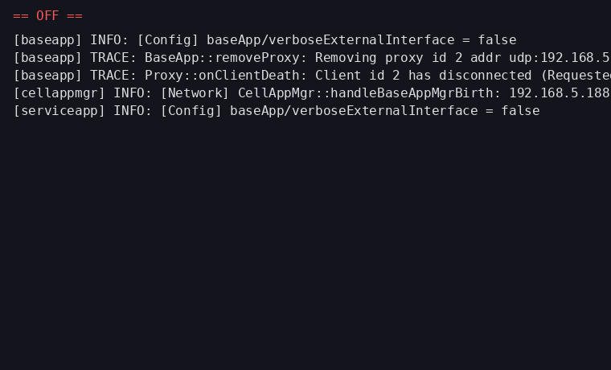

### baseapp

only when **off**:

```
INFO: [Config] baseApp/verboseExternalInterface = false
TRACE: BaseApp::removeProxy: Removing proxy id 2 addr udp:192.168.5.188
TRACE: Proxy::onClientDeath: Client id 2 has disconnected (Requested by client)
```

only when **on**:

```
INFO: [Config] baseApp/verboseExternalInterface = true (default: false)
TRACE: BaseApp::removeProxy: Removing proxy id 1 addr udp:192.168.5.188
TRACE: Proxy::onClientDeath: Client id 1 has disconnected (Requested by client)
```

### cellappmgr

only when **off**:

```
INFO: [Network] CellAppMgr::handleBaseAppMgrBirth: 192.168.5.188
```

### serviceapp

only when **off**:

```
INFO: [Config] baseApp/verboseExternalInterface = false
```

only when **on**:

```
INFO: [Config] baseApp/verboseExternalInterface = true (default: false)
```


## BaseAppConfig.warnOnNoDef

xml `baseApp/warnOnNoDef`, default `true` (captured 2026-11-23T02:46:18)

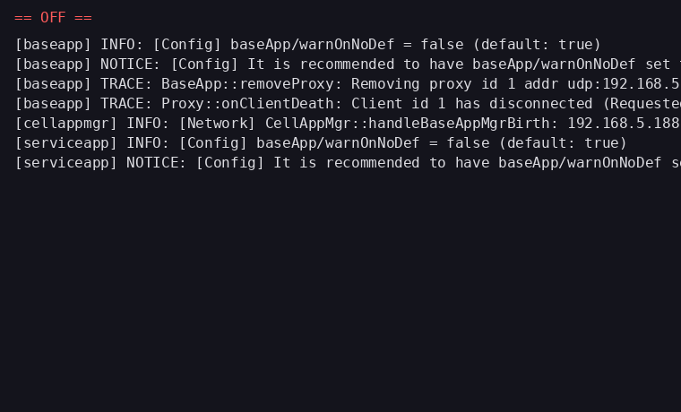

### baseapp

only when **off**:

```
INFO: [Config] baseApp/warnOnNoDef = false (default: true)
NOTICE: [Config] It is recommended to have baseApp/warnOnNoDef set to true and to make use of <TempProperties> section in the .def files
TRACE: BaseApp::removeProxy: Removing proxy id 1 addr udp:192.168.5.188
TRACE: Proxy::onClientDeath: Client id 1 has disconnected (Requested by client)
```

only when **on**:

```
INFO: [Config] baseApp/warnOnNoDef = true
TRACE: BaseApp::removeProxy: Removing proxy id 2 addr udp:192.168.5.188
TRACE: Proxy::onClientDeath: Client id 2 has disconnected (Requested by client)
```

### cellappmgr

only when **off**:

```
INFO: [Network] CellAppMgr::handleBaseAppMgrBirth: 192.168.5.188
```

### serviceapp

only when **off**:

```
INFO: [Config] baseApp/warnOnNoDef = false (default: true)
NOTICE: [Config] It is recommended to have baseApp/warnOnNoDef set to true and to make use of <TempProperties> section in the .def files
```

only when **on**:

```
INFO: [Config] baseApp/warnOnNoDef = true
```


## BotsConfig.shouldListenForGeometryMappings

xml `bots/shouldListenForGeometryMappings`, default `false` (captured 2026-11-23T02:47:56)

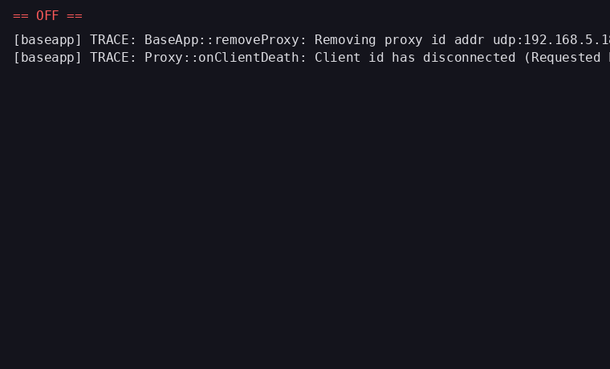

### baseapp

only when **off**:

```
TRACE: BaseApp::removeProxy: Removing proxy id addr udp:192.168.5.188
TRACE: Proxy::onClientDeath: Client id has disconnected (Requested by client)
```

only when **on**:

```
TRACE: BaseApp::removeProxy: Removing proxy id 1 addr udp:192.168.5.188
TRACE: Proxy::onClientDeath: Client id 1 has disconnected (Requested by client)
```


## BotsConfig.shouldUseRandomName

xml `bots/shouldUseRandomName`, default `true` (captured 2026-11-23T02:49:34)

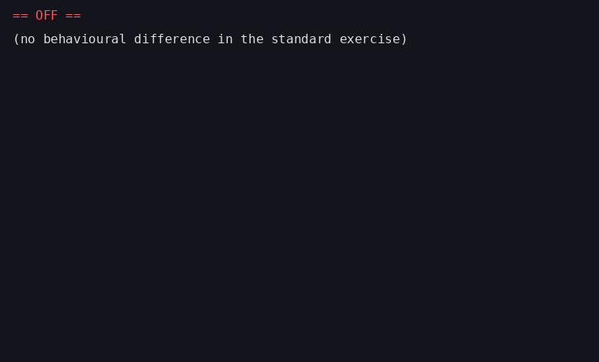


## BotsConfig.shouldUseScripts

xml `bots/shouldUseScripts`, default `true` (captured 2026-11-23T02:51:17)

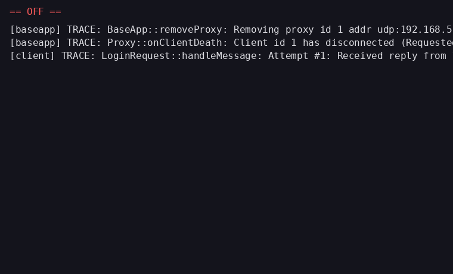

### baseapp

only when **off**:

```
TRACE: BaseApp::removeProxy: Removing proxy id 1 addr udp:192.168.5.188
TRACE: Proxy::onClientDeath: Client id 1 has disconnected (Requested by client)
```

only when **on**:

```
ERROR: [Network] 1 reports of 'Exception occurred: 192.168.5.188' on 'REASON_NO_SUCH_PORT' in the last 2ms
TRACE: BaseApp::removeProxy: Removing proxy id addr udp:192.168.5.188
TRACE: Proxy::onClientDeath: Client id has disconnected (Requested by client)
```

### client

only when **off**:

```
TRACE: LoginRequest::handleMessage: Attempt #1: Received reply from 192.168.5.188 (after 0.0s)
```


## BotsConfig.shouldUseTCP

xml `bots/shouldUseTCP`, default `false` (captured 2026-11-23T02:52:58)

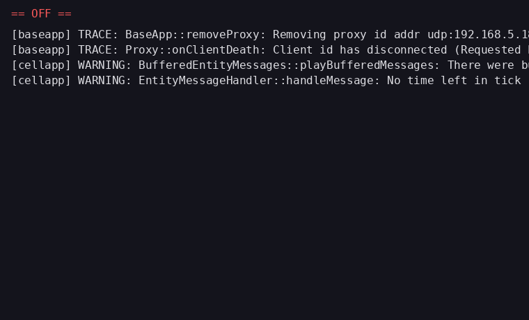

### baseapp

only when **off**:

```
TRACE: BaseApp::removeProxy: Removing proxy id addr udp:192.168.5.188
TRACE: Proxy::onClientDeath: Client id has disconnected (Requested by client)
```

only when **on**:

```
TRACE: BaseApp::removeProxy: Removing proxy id 1 addr udp:192.168.5.188
TRACE: Proxy::onClientDeath: Client id 1 has disconnected (Requested by client)
```

### cellapp

only when **off**:

```
WARNING: BufferedEntityMessages::playBufferedMessages: There were buffered messages. Played 1 of 1
WARNING: EntityMessageHandler::handleMessage: No time left in tick . Buffering 'createEntityNearEntity' and similar messages this tick. Num previously in buffer = 0.
```

### cellappmgr

only when **on**:

```
INFO: [Network] CellAppMgr::handleBaseAppMgrBirth: 192.168.5.188
```


## BotsConfig.shouldUseWebSockets

xml `bots/shouldUseWebSockets`, default `false` (captured 2026-11-23T02:54:44)

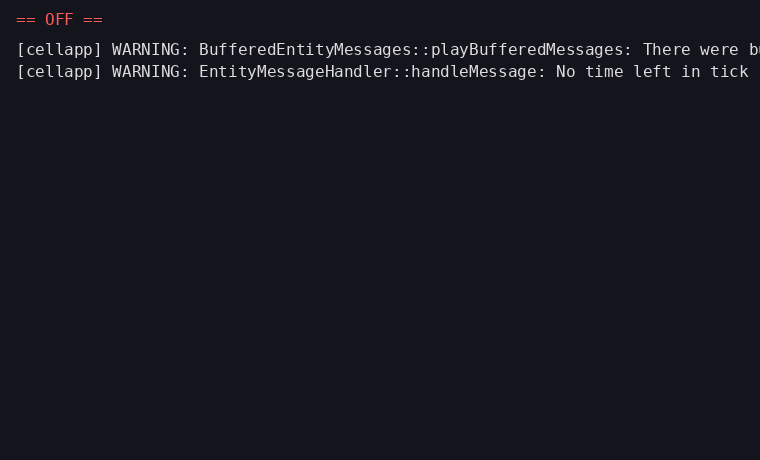

### cellapp

only when **off**:

```
WARNING: BufferedEntityMessages::playBufferedMessages: There were buffered messages. Played 1 of 1
WARNING: EntityMessageHandler::handleMessage: No time left in tick . Buffering 'createEntityNearEntity' and similar messages this tick. Num previously in buffer = 0.
```


## CellAppConfig.enforceGhostDecorators

xml `cellApp/enforceGhostDecorators`, default `true` (captured 2026-11-23T02:56:25)

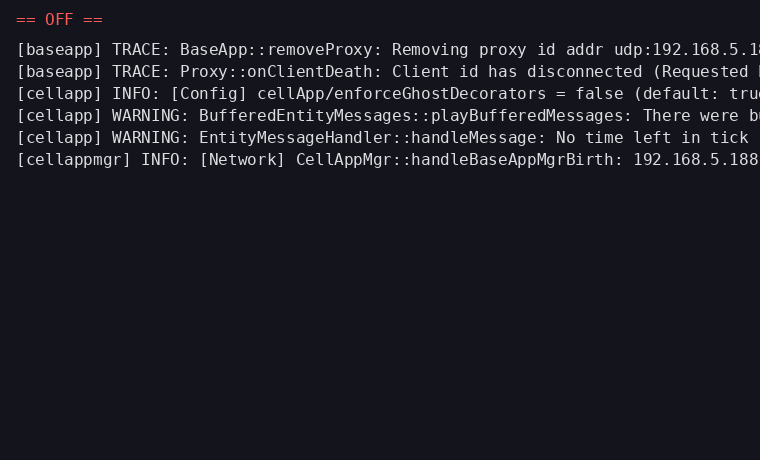

### baseapp

only when **off**:

```
TRACE: BaseApp::removeProxy: Removing proxy id addr udp:192.168.5.188
TRACE: Proxy::onClientDeath: Client id has disconnected (Requested by client)
```

only when **on**:

```
TRACE: BaseApp::removeProxy: Removing proxy id 1 addr udp:192.168.5.188
TRACE: Proxy::onClientDeath: Client id 1 has disconnected (Requested by client)
```

### cellapp

only when **off**:

```
INFO: [Config] cellApp/enforceGhostDecorators = false (default: true)
WARNING: BufferedEntityMessages::playBufferedMessages: There were buffered messages. Played 1 of 1
WARNING: EntityMessageHandler::handleMessage: No time left in tick . Buffering 'createEntityNearEntity' and similar messages this tick. Num previously in buffer = 0.
```

only when **on**:

```
INFO: [Config] cellApp/enforceGhostDecorators = true
```

### cellappmgr

only when **off**:

```
INFO: [Network] CellAppMgr::handleBaseAppMgrBirth: 192.168.5.188
```


## CellAppConfig.fastShutdown

xml `cellApp/fastShutdown`, default `true` (captured 2026-11-23T02:58:04)

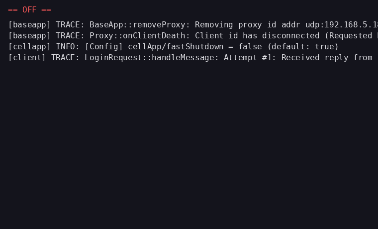

### baseapp

only when **off**:

```
TRACE: BaseApp::removeProxy: Removing proxy id addr udp:192.168.5.188
TRACE: Proxy::onClientDeath: Client id has disconnected (Requested by client)
```

only when **on**:

```
TRACE: BaseApp::removeProxy: Removing proxy id 1 addr udp:192.168.5.188
TRACE: Proxy::onClientDeath: Client id 1 has disconnected (Requested by client)
```

### cellapp

only when **off**:

```
INFO: [Config] cellApp/fastShutdown = false (default: true)
```

only when **on**:

```
INFO: [Config] cellApp/fastShutdown = true
```

### client

only when **off**:

```
TRACE: LoginRequest::handleMessage: Attempt #1: Received reply from 192.168.5.188 (after 0.0s)
```


## CellAppConfig.loadDominantTextureMaps

xml `cellApp/loadDominantTextureMaps`, default `false` (captured 2026-11-23T02:59:45)

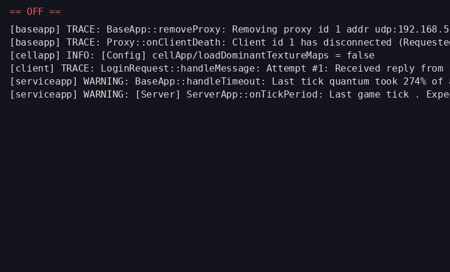

### baseapp

only when **off**:

```
TRACE: BaseApp::removeProxy: Removing proxy id 1 addr udp:192.168.5.188
TRACE: Proxy::onClientDeath: Client id 1 has disconnected (Requested by client)
```

only when **on**:

```
TRACE: BaseApp::removeProxy: Removing proxy id addr udp:192.168.5.188
TRACE: Proxy::onClientDeath: Client id has disconnected (Requested by client)
```

### cellapp

only when **off**:

```
INFO: [Config] cellApp/loadDominantTextureMaps = false
```

only when **on**:

```
INFO: BufferedInputMessages::playBufferedMessages: Played 1 message, buffer now empty
INFO: [Config] cellApp/loadDominantTextureMaps = true (default: false)
```

### client

only when **off**:

```
TRACE: LoginRequest::handleMessage: Attempt #1: Received reply from 192.168.5.188 (after 0.2s)
```

### serviceapp

only when **off**:

```
WARNING: BaseApp::handleTimeout: Last tick quantum took 274% of allocation (0.27 seconds)! Proxy clients may have been starved!
WARNING: [Server] ServerApp::onTickPeriod: Last game tick . Expected 0.10.
```


## CellAppConfig.sendDetailedPlayerVehicles

xml `cellApp/sendDetailedPlayerVehicles`, default `false` (captured 2026-11-23T03:01:26)


### cellapp

only when **off**:

```
INFO: [Config] cellApp/sendDetailedPlayerVehicles = false
```

only when **on**:

```
INFO: [Config] cellApp/sendDetailedPlayerVehicles = true (default: false)
```


## CellAppConfig.shouldNavigationDropPosition

xml `cellApp/shouldNavigationDropPosition`, default `false` (captured 2026-11-23T03:03:06)

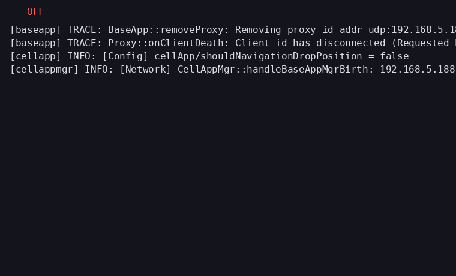

### baseapp

only when **off**:

```
TRACE: BaseApp::removeProxy: Removing proxy id addr udp:192.168.5.188
TRACE: Proxy::onClientDeath: Client id has disconnected (Requested by client)
```

only when **on**:

```
TRACE: BaseApp::removeProxy: Removing proxy id 1 addr udp:192.168.5.188
TRACE: Proxy::onClientDeath: Client id 1 has disconnected (Requested by client)
```

### cellapp

only when **off**:

```
INFO: [Config] cellApp/shouldNavigationDropPosition = false
```

only when **on**:

```
INFO: [Config] cellApp/shouldNavigationDropPosition = true (default: false)
```

### cellappmgr

only when **off**:

```
INFO: [Network] CellAppMgr::handleBaseAppMgrBirth: 192.168.5.188
```


## CellAppConfig.shouldResolveMailBoxes

xml `cellApp/shouldResolveMailBoxes`, default `false` (captured 2026-11-23T03:04:46)

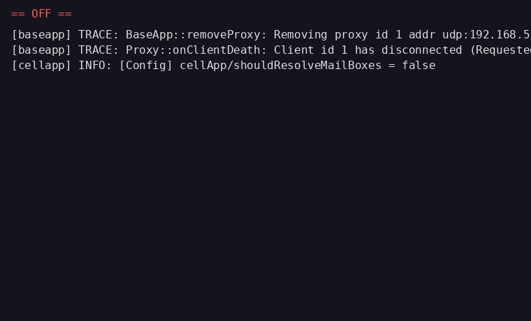

### baseapp

only when **off**:

```
TRACE: BaseApp::removeProxy: Removing proxy id 1 addr udp:192.168.5.188
TRACE: Proxy::onClientDeath: Client id 1 has disconnected (Requested by client)
```

only when **on**:

```
TRACE: BaseApp::removeProxy: Removing proxy id addr udp:192.168.5.188
TRACE: Proxy::onClientDeath: Client id has disconnected (Requested by client)
```

### cellapp

only when **off**:

```
INFO: [Config] cellApp/shouldResolveMailBoxes = false
```

only when **on**:

```
INFO: [Config] cellApp/shouldResolveMailBoxes = true (default: false)
```

### cellappmgr

only when **on**:

```
INFO: CellAppMgr::handleCellAppMgrBirth: 192.168.5.188
INFO: [Network] CellAppMgr::handleBaseAppMgrBirth: 192.168.5.188
```

### client

only when **on**:

```
TRACE: LoginRequest::handleMessage: Attempt #1: Received reply from 192.168.5.188 (after 0.2s)
```


## CellAppConfig.treatAllOtherEntitiesAsGhosts

xml `cellApp/treatAllOtherEntitiesAsGhosts`, default `true` (captured 2026-11-23T03:06:25)


### baseapp

only when **on**:

```
ERROR: [Network] 1 reports of 'Exception occurred: 192.168.5.188' on 'REASON_NO_SUCH_PORT' in the last 1ms
```

### cellapp

only when **off**:

```
INFO: [Config] cellApp/treatAllOtherEntitiesAsGhosts = false (default: true)
```

only when **on**:

```
INFO: Production Mode: Treating other entities as ghosts enabled. This may reduce your performance.
INFO: [Config] cellApp/treatAllOtherEntitiesAsGhosts = true
```


## CellAppMgrConfig.shouldArchiveSpaceData

xml `cellAppMgr/shouldArchiveSpaceData`, default `true` (captured 2026-11-23T03:08:02)

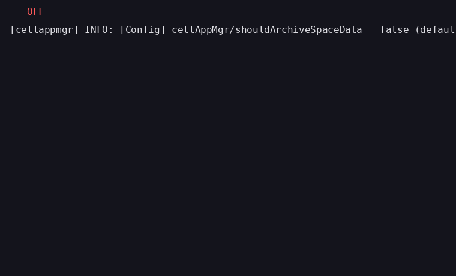

### cellappmgr

only when **off**:

```
INFO: [Config] cellAppMgr/shouldArchiveSpaceData = false (default: true)
```

only when **on**:

```
INFO: CellAppMgr::handleCellAppMgrBirth: 192.168.5.188
INFO: [Config] cellAppMgr/shouldArchiveSpaceData = true
```


## CellAppMgrConfig.shouldLimitBalanceToChunks

xml `cellAppMgr/shouldLimitBalanceToChunks`, default `true` (captured 2026-11-23T03:09:42)

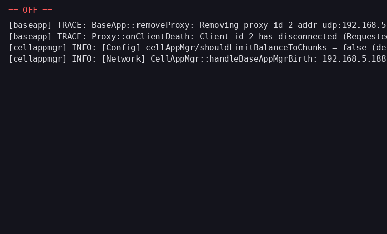

### baseapp

only when **off**:

```
TRACE: BaseApp::removeProxy: Removing proxy id 2 addr udp:192.168.5.188
TRACE: Proxy::onClientDeath: Client id 2 has disconnected (Requested by client)
```

only when **on**:

```
TRACE: BaseApp::removeProxy: Removing proxy id 1 addr udp:192.168.5.188
TRACE: Proxy::onClientDeath: Client id 1 has disconnected (Requested by client)
```

### cellappmgr

only when **off**:

```
INFO: [Config] cellAppMgr/shouldLimitBalanceToChunks = false (default: true)
INFO: [Network] CellAppMgr::handleBaseAppMgrBirth: 192.168.5.188
```

only when **on**:

```
INFO: [Config] cellAppMgr/shouldLimitBalanceToChunks = true
```

### client

only when **on**:

```
TRACE: LoginRequest::handleMessage: Attempt #1: Received reply from 192.168.5.188 (after 0.2s)
```


## CellAppMgrConfig.shouldMetaLoadBalance

xml `cellAppMgr/shouldMetaLoadBalance`, default `(getter)` (captured 2026-11-23T03:11:24)

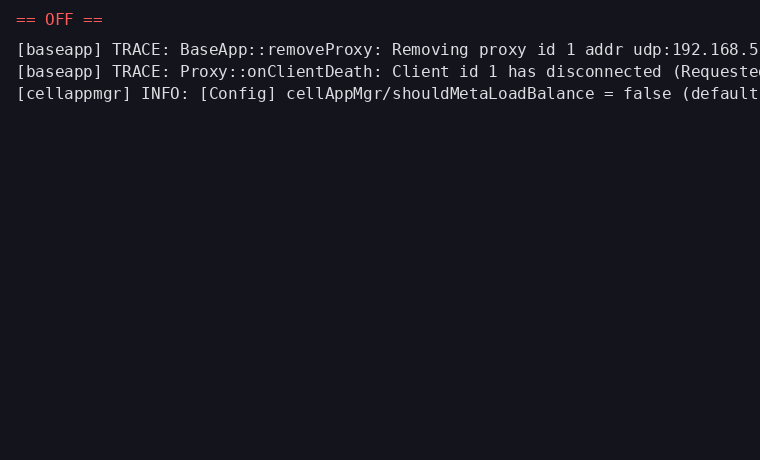

### baseapp

only when **off**:

```
TRACE: BaseApp::removeProxy: Removing proxy id 1 addr udp:192.168.5.188
TRACE: Proxy::onClientDeath: Client id 1 has disconnected (Requested by client)
```

only when **on**:

```
TRACE: BaseApp::removeProxy: Removing proxy id addr udp:192.168.5.188
TRACE: Proxy::onClientDeath: Client id has disconnected (Requested by client)
```

### cellappmgr

only when **off**:

```
INFO: [Config] cellAppMgr/shouldMetaLoadBalance = false (default: true)
```

only when **on**:

```
INFO: [Config] cellAppMgr/shouldMetaLoadBalance = true
```

### client

only when **on**:

```
TRACE: LoginRequest::handleMessage: Attempt #1: Received reply from 192.168.5.188 (after 0.2s)
```


## CellAppMgrConfig.shouldShowMetaLoadBalanceDebug

xml `cellAppMgr/shouldShowMetaLoadBalanceDebug`, default `false` (captured 2026-11-23T03:13:06)

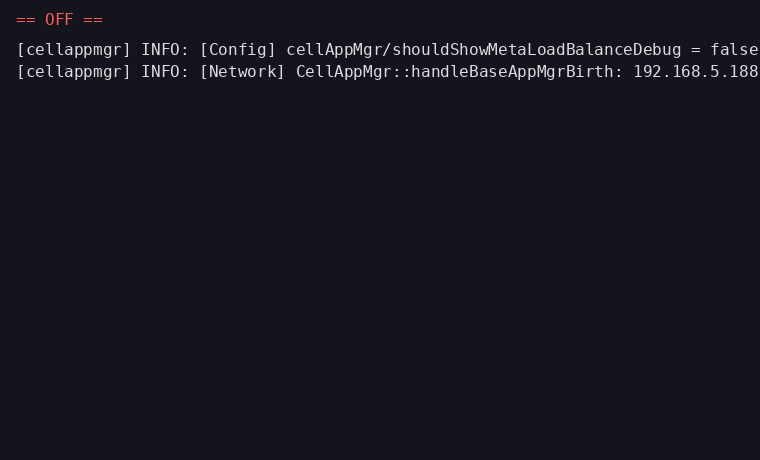

### baseappmgr

only when **on**:

```
INFO: [ProcessIP] BaseAppMgr::add: Not allowing BaseApp at 192.168.5.188 to register yet (No init data from DBApp Alpha)
```

### cellappmgr

only when **off**:

```
INFO: [Config] cellAppMgr/shouldShowMetaLoadBalanceDebug = false
INFO: [Network] CellAppMgr::handleBaseAppMgrBirth: 192.168.5.188
```

only when **on**:

```
INFO: CellAppMgr::handleCellAppMgrBirth: 192.168.5.188
INFO: [Config] cellAppMgr/shouldShowMetaLoadBalanceDebug = true (default: false)
```

### dbapp

only when **on**:

```
WARNING: [Network] PacketReceiver::handleInputNotification: last received from 192.168.5.188, stopping socket processing after .047ms (processed 1 packets), receive queue at 0 bytesINFO: ChannelMap::find: Creating anonymous channel to 192.168.5.188
```


## DBAppConfig.shouldCacheLogOnRecords

xml `dbApp/shouldCacheLogOnRecords`, default `false` (captured 2026-11-23T03:14:46)

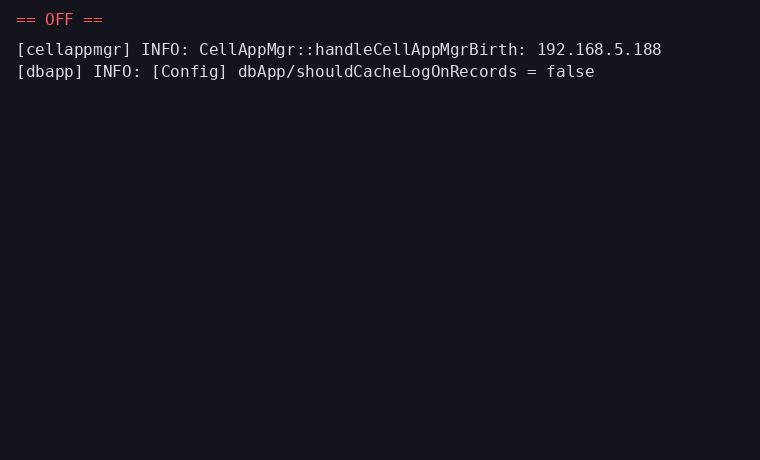

### cellappmgr

only when **off**:

```
INFO: CellAppMgr::handleCellAppMgrBirth: 192.168.5.188
```

### dbapp

only when **off**:

```
INFO: [Config] dbApp/shouldCacheLogOnRecords = false
```

only when **on**:

```
INFO: [Config] dbApp/shouldCacheLogOnRecords = true (default: false)
```


## DBAppConfig.shouldDelayLookUpSend

xml `dbApp/shouldDelayLookUpSend`, default `false` (captured 2026-11-23T03:16:26)

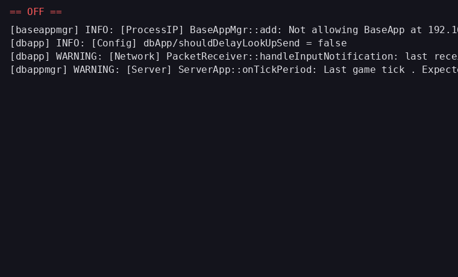

### baseappmgr

only when **off**:

```
INFO: [ProcessIP] BaseAppMgr::add: Not allowing BaseApp at 192.168.5.188 to register yet (No init data from DBApp Alpha)
```

### dbapp

only when **off**:

```
INFO: [Config] dbApp/shouldDelayLookUpSend = false
WARNING: [Network] PacketReceiver::handleInputNotification: last received from 192.168.5.188, stopping socket processing after .055ms (processed 1 packets), receive queue at 0 bytesINFO: ChannelMap::find: Creating anonymous channel to 192.168.5.188
```

only when **on**:

```
INFO: [Config] dbApp/shouldDelayLookUpSend = true (default: false)
```

### dbappmgr

only when **off**:

```
WARNING: [Server] ServerApp::onTickPeriod: Last game tick . Expected 0.10.
```


## LoginAppConfig.allowLogin

xml `loginApp/allowLogin`, default `false` (captured 2026-11-23T03:18:05)

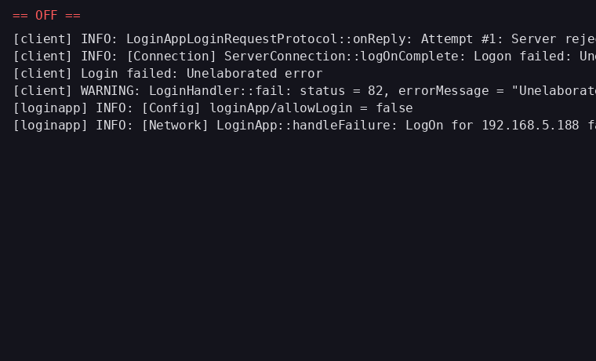

### baseapp

only when **on**:

```
DEBUG: Proxy::addCreateBasePlayerToChannelBundle: Creating player on client
DEBUG: Proxy::enableEntities
ERROR: [Network] Exception occurred: 'REASON_NO_SUCH_PORT' on '192.168.5.188'
INFO: Base::Base: ClientAvatar
INFO: Base::~Base: ClientAvatar
INFO: ClientAvatar.
INFO: ClientAvatar.__init__: {'prop1': 1} 0
INFO: LoginHandler:: from 192.168.5.188. Attempt 1
TRACE: BaseApp: at udp:192.168.5.188
TRACE: BaseApp::removeProxy: Removing proxy id addr udp:192.168.5.188
TRACE: Proxy::onClientDeath: Client id has disconnected (Requested by client)
```

### baseappmgr

only when **on**:

```
INFO: [ProcessIP] BaseAppMgr::add: Not allowing BaseApp at 192.168.5.188 to register yet (No init data from DBApp Alpha)
```

### cellapp

only when **on**:

```
INFO: Cell::createEntityInternal: New ClientAvatar
INFO: Cell::entityDestroyed: has been destroyed.
INFO: ChannelMap::find: Creating anonymous channel to 192.168.5.188
INFO: ClientAvatar.__init__: {}
```

### cellappmgr

only when **on**:

```
INFO: CellAppMgr::handleCellAppMgrBirth: 192.168.5.188
```

### client

only when **off**:

```
INFO: LoginAppLoginRequestProtocol::onReply: Attempt #1: Server rejected our login. Reject status: 82, reject data (optional): none
INFO: [Connection] ServerConnection::logOnComplete: Logon failed: Unelaborated error
Login failed: Unelaborated error
WARNING: LoginHandler::fail: status = 82, errorMessage = "Unelaborated error"
```

only when **on**:

```
Connected to 192.168.5.188
DEBUG: LoginHandler::onBaseAppLoginSuccess: Got reply from BaseApp channel udp:192.168.5.188
DEBUG: LoginHandler::onLoginAppLoginSuccess: BaseApp@192.168.5.188 over UDP (# requests: 10, retry interval:1.0s, timeout interval: 8.0s)
DEBUG: LoginRequest::onTransportConnect: Attempt #1 to BaseApp 192.168.5.188; took 0.0s, time left = 8.0s
DEBUG: [Connection] ServerConnection::enableEntities: Enabling entities
DEBUG: [Connection] ServerConnection::logOn: from: 192.168.5.188
DEBUG: [Connection] ServerConnection::logOn: status==LOGGED_ON
DEBUG: [Connection] ServerConnection::logOn: to: 192.168.5.188
TRACE: LoginHandler::sendNextRequest: From 192.168.5.188, attempt #1 / 10 to BaseApp 192.168.5.188
```

### dbapp

only when **on**:

```
INFO: DBApp::logOn: cui
WARNING: [Network] PacketReceiver::handleInputNotification: last received from 192.168.5.188, stopping socket processing after .286ms (processed 1 packets), receive queue at 0 bytesINFO: ChannelMap::find: Creating anonymous channel to 192.168.5.188
```

### loginapp

only when **off**:

```
INFO: [Config] loginApp/allowLogin = false
INFO: [Network] LoginApp::handleFailure: LogOn for 192.168.5.188 failed, LogOnStatus: 82, description 'none'.
```

only when **on**:

```
INFO: LoginApp::login: Attempt from 192.168.5.188
INFO: LoginApp::login: Logging in user 'cui' (192.168.5.188)
INFO: [Config] loginApp/allowLogin = true (default: false)
```


## LoginAppConfig.allowProbe

xml `loginApp/allowProbe`, default `false` (captured 2026-11-23T03:19:53)

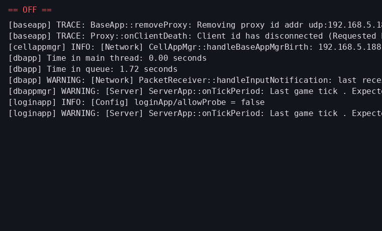

### baseapp

only when **off**:

```
TRACE: BaseApp::removeProxy: Removing proxy id addr udp:192.168.5.188
TRACE: Proxy::onClientDeath: Client id has disconnected (Requested by client)
```

only when **on**:

```
TRACE: BaseApp::removeProxy: Removing proxy id 1 addr udp:192.168.5.188
TRACE: Proxy::onClientDeath: Client id 1 has disconnected (Requested by client)
```

### baseappmgr

only when **on**:

```
INFO: [ProcessIP] BaseAppMgr::add: Not allowing BaseApp at 192.168.5.188 to register yet (No init data from DBApp Alpha)
```

### cellappmgr

only when **off**:

```
INFO: [Network] CellAppMgr::handleBaseAppMgrBirth: 192.168.5.188
```

### client

only when **on**:

```
TRACE: LoginRequest::handleMessage: Attempt #1: Received reply from 192.168.5.188 (after 0.2s)
```

### dbapp

only when **off**:

```
Time in main thread: 0.00 seconds
Time in queue: 1.72 seconds
WARNING: [Network] PacketReceiver::handleInputNotification: last received from 192.168.5.188, stopping socket processing after .735ms (processed 1 packets), receive queue at 0 bytesWARNING: [CStdMF] GetBaseAppMgrInitDataTask :
```

only when **on**:

```
WARNING: [Network] PacketReceiver::handleInputNotification: last received from 192.168.5.188, stopping socket processing after .366ms (processed 1 packets), receive queue at 0 bytesINFO: ChannelMap::find: Creating anonymous channel to 192.168.5.188
```

### dbappmgr

only when **off**:

```
WARNING: [Server] ServerApp::onTickPeriod: Last game tick . Expected 0.10.
```

### loginapp

only when **off**:

```
INFO: [Config] loginApp/allowProbe = false
WARNING: [Server] ServerApp::onTickPeriod: Last game tick . Expected 0.10.
```

only when **on**:

```
ERROR: [Config] Production Mode: bw.xml/loginApp/allowProbe is enabled. This is a development-time feature only and should be disabled during production.
INFO: [Config] loginApp/allowProbe = true (default: false)
```


## LoginAppConfig.allowUnencryptedLogins

xml `loginApp/allowUnencryptedLogins`, default `false` (captured 2026-11-23T03:21:40)

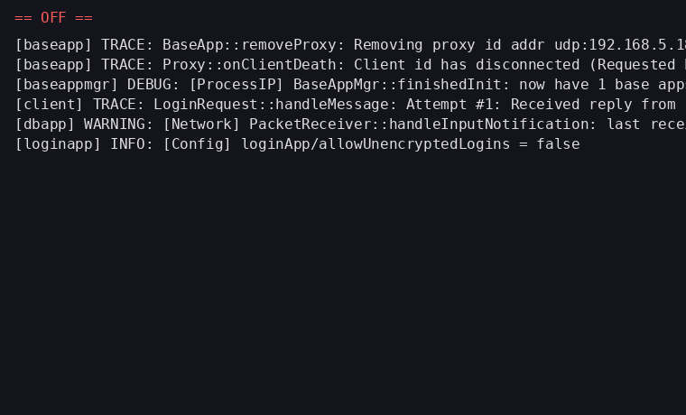

### baseapp

only when **off**:

```
TRACE: BaseApp::removeProxy: Removing proxy id addr udp:192.168.5.188
TRACE: Proxy::onClientDeath: Client id has disconnected (Requested by client)
```

only when **on**:

```
TRACE: BaseApp::removeProxy: Removing proxy id 1 addr udp:192.168.5.188
TRACE: Proxy::onClientDeath: Client id 1 has disconnected (Requested by client)
WARNING: /home/cui/workspaces/BigWorld/programming/bigworld/server/baseapp/baseapp.cpp: Profile backup
WARNING: /home/cui/workspaces/BigWorld/programming/bigworld/server/baseapp/baseapp.cpp: Profile tickGameTime
```

### baseappmgr

only when **off**:

```
DEBUG: [ProcessIP] BaseAppMgr::finishedInit: now have 1 base apps and 1 service apps ready
```

only when **on**:

```
DEBUG: [ProcessIP] BaseAppMgr::finishedInit: now have 2 base apps and 0 service apps ready
WARNING: [Server] ServerApp::onTickPeriod: Last game tick . Expected 0.10.
```

### cellapp

only when **on**:

```
WARNING: /home/cui/workspaces/BigWorld/programming/bigworld/server/cellapp/cellapp.cpp: Profile backup
WARNING: /home/cui/workspaces/BigWorld/programming/bigworld/server/cellapp/cellapp.cpp: Profile gameTick
```

### client

only when **off**:

```
TRACE: LoginRequest::handleMessage: Attempt #1: Received reply from 192.168.5.188 (after 0.2s)
```

### dbapp

only when **off**:

```
WARNING: [Network] PacketReceiver::handleInputNotification: last received from 192.168.5.188, stopping socket processing after .525ms (processed 1 packets), receive queue at 0 bytesINFO: ChannelMap::find: Creating anonymous channel to 192.168.5.188
```

only when **on**:

```
WARNING: [Network] PacketReceiver::handleInputNotification: last received from 192.168.5.188, stopping socket processing after .620ms (processed 1 packets), receive queue at 0 bytesINFO: ChannelMap::find: Creating anonymous channel to 192.168.5.188
```

### dbappmgr

only when **on**:

```
WARNING: [Server] ServerApp::onTickPeriod: Last game tick . Expected 0.10.
```

### loginapp

only when **off**:

```
INFO: [Config] loginApp/allowUnencryptedLogins = false
```

only when **on**:

```
INFO: [Config] loginApp/allowUnencryptedLogins = true (default: false)
WARNING: [Server] ServerApp::onTickPeriod: Last game tick . Expected 0.10.
```


## LoginAppConfig.logProbes

xml `loginApp/logProbes`, default `true` (captured 2026-11-23T03:23:30)

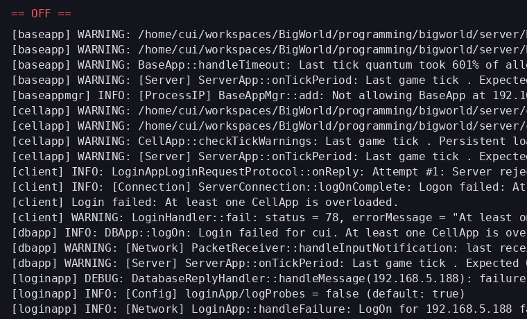

### baseapp

only when **off**:

```
WARNING: /home/cui/workspaces/BigWorld/programming/bigworld/server/baseapp/baseapp.cpp: Profile backup
WARNING: /home/cui/workspaces/BigWorld/programming/bigworld/server/baseapp/baseapp.cpp: Profile tickGameTime
WARNING: BaseApp::handleTimeout: Last tick quantum took 601% of allocation (0.60 seconds)! Proxy clients may have been starved!
WARNING: [Server] ServerApp::onTickPeriod: Last game tick . Expected 0.10.
```

only when **on**:

```
DEBUG: Proxy::addCreateBasePlayerToChannelBundle: Creating player on client
DEBUG: Proxy::enableEntities
ERROR: [Network] Exception occurred: 'REASON_NO_SUCH_PORT' on '192.168.5.188'
INFO: Base::Base: ClientAvatar
INFO: Base::~Base: ClientAvatar
INFO: ClientAvatar.
INFO: ClientAvatar.__init__: {'prop1': 1} 0
INFO: LoginHandler:: from 192.168.5.188. Attempt 1
TRACE: BaseApp: at udp:192.168.5.188
TRACE: BaseApp::removeProxy: Removing proxy id addr udp:192.168.5.188
TRACE: Proxy::onClientDeath: Client id has disconnected (Requested by client)
```

### baseappmgr

only when **off**:

```
INFO: [ProcessIP] BaseAppMgr::add: Not allowing BaseApp at 192.168.5.188 to register yet (No init data from DBApp Alpha)
```

### cellapp

only when **off**:

```
WARNING: /home/cui/workspaces/BigWorld/programming/bigworld/server/cellapp/cellapp.cpp: Profile backup
WARNING: /home/cui/workspaces/BigWorld/programming/bigworld/server/cellapp/cellapp.cpp: Profile gameTick
WARNING: CellApp::checkTickWarnings: Last game tick . Persistent load time = 0.46. Spare time 0.00.
WARNING: [Server] ServerApp::onTickPeriod: Last game tick . Expected 0.10.
```

only when **on**:

```
INFO: Cell::createEntityInternal: New ClientAvatar
INFO: Cell::entityDestroyed: has been destroyed.
INFO: ChannelMap::find: Creating anonymous channel to 192.168.5.188
INFO: ClientAvatar.__init__: {}
WARNING: BufferedEntityMessages::playBufferedMessages: There were buffered messages. Played 1 of 1
WARNING: EntityMessageHandler::handleMessage: No time left in tick . Buffering 'createEntityNearEntity' and similar messages this tick. Num previously in buffer = 0.
```

### cellappmgr

only when **on**:

```
INFO: [Network] CellAppMgr::handleBaseAppMgrBirth: 192.168.5.188
WARNING: [Server] ServerApp::onTickPeriod: Last game tick . Expected 0.10.
```

### client

only when **off**:

```
INFO: LoginAppLoginRequestProtocol::onReply: Attempt #1: Server rejected our login. Reject status: 78, reject data (optional): At least one CellApp is overloaded.
INFO: [Connection] ServerConnection::logOnComplete: Logon failed: At least one CellApp is overloaded.
Login failed: At least one CellApp is overloaded.
WARNING: LoginHandler::fail: status = 78, errorMessage = "At least one CellApp is overloaded."
```

only when **on**:

```
Connected to 192.168.5.188
DEBUG: LoginHandler::onBaseAppLoginSuccess: Got reply from BaseApp channel udp:192.168.5.188
DEBUG: LoginHandler::onLoginAppLoginSuccess: BaseApp@192.168.5.188 over UDP (# requests: 10, retry interval:1.0s, timeout interval: 8.0s)
DEBUG: LoginRequest::onTransportConnect: Attempt #1 to BaseApp 192.168.5.188; took 0.0s, time left = 8.0s
DEBUG: [Connection] ServerConnection::enableEntities: Enabling entities
DEBUG: [Connection] ServerConnection::logOn: from: 192.168.5.188
DEBUG: [Connection] ServerConnection::logOn: status==LOGGED_ON
DEBUG: [Connection] ServerConnection::logOn: to: 192.168.5.188
TRACE: LoginHandler::sendNextRequest: From 192.168.5.188, attempt #1 / 10 to BaseApp 192.168.5.188
TRACE: LoginRequest::handleMessage: Attempt #1: Received reply from 192.168.5.188 (after 0.2s)
```

### dbapp

only when **off**:

```
INFO: DBApp::logOn: Login failed for cui. At least one CellApp is overloaded.
WARNING: [Network] PacketReceiver::handleInputNotification: last received from 192.168.5.188, stopping socket processing after .308ms (processed 1 packets), receive queue at 0 bytesINFO: ChannelMap::find: Creating anonymous channel to 192.168.5.188
WARNING: [Server] ServerApp::onTickPeriod: Last game tick . Expected 0.10.
```

only when **on**:

```
INFO: DBApp::logOn: cui
```

### loginapp

only when **off**:

```
DEBUG: DatabaseReplyHandler::handleMessage(192.168.5.188): failure due to overload (status=4e)
INFO: [Config] loginApp/logProbes = false (default: true)
INFO: [Network] LoginApp::handleFailure: LogOn for 192.168.5.188 failed, LogOnStatus: 78, description 'At least one CellApp is overloaded.'.
```

only when **on**:

```
INFO: [Config] loginApp/logProbes = true
```


## LoginAppConfig.passwordlessLoginsOnly

xml `loginApp/passwordlessLoginsOnly`, default `false` (captured 2026-11-23T03:25:07)

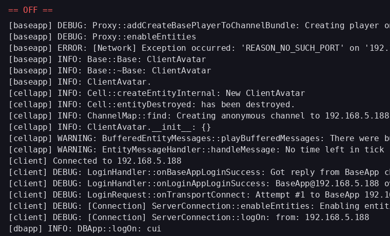

### baseapp

only when **off**:

```
DEBUG: Proxy::addCreateBasePlayerToChannelBundle: Creating player on client
DEBUG: Proxy::enableEntities
ERROR: [Network] Exception occurred: 'REASON_NO_SUCH_PORT' on '192.168.5.188'
INFO: Base::Base: ClientAvatar
INFO: Base::~Base: ClientAvatar
INFO: ClientAvatar.
INFO: ClientAvatar.__init__: {'prop1': 1} 0
INFO: LoginHandler:: from 192.168.5.188. Attempt 1
TRACE: BaseApp: at udp:192.168.5.188
TRACE: BaseApp::removeProxy: Removing proxy id 1 addr udp:192.168.5.188
TRACE: Proxy::onClientDeath: Client id 1 has disconnected (Requested by client)
```

### cellapp

only when **off**:

```
INFO: Cell::createEntityInternal: New ClientAvatar
INFO: Cell::entityDestroyed: has been destroyed.
INFO: ChannelMap::find: Creating anonymous channel to 192.168.5.188
INFO: ClientAvatar.__init__: {}
WARNING: BufferedEntityMessages::playBufferedMessages: There were buffered messages. Played 1 of 1
WARNING: EntityMessageHandler::handleMessage: No time left in tick . Buffering 'createEntityNearEntity' and similar messages this tick. Num previously in buffer = 0.
```

### client

only when **off**:

```
Connected to 192.168.5.188
DEBUG: LoginHandler::onBaseAppLoginSuccess: Got reply from BaseApp channel udp:192.168.5.188
DEBUG: LoginHandler::onLoginAppLoginSuccess: BaseApp@192.168.5.188 over UDP (# requests: 10, retry interval:1.0s, timeout interval: 8.0s)
DEBUG: LoginRequest::onTransportConnect: Attempt #1 to BaseApp 192.168.5.188; took 0.0s, time left = 8.0s
DEBUG: [Connection] ServerConnection::enableEntities: Enabling entities
DEBUG: [Connection] ServerConnection::logOn: from: 192.168.5.188
DEBUG: [Connection] ServerConnection::logOn: status==LOGGED_ON
DEBUG: [Connection] ServerConnection::logOn: to: 192.168.5.188
TRACE: LoginHandler::sendNextRequest: From 192.168.5.188, attempt #1 / 10 to BaseApp 192.168.5.188
TRACE: LoginRequest::handleMessage: Attempt #1: Received reply from 192.168.5.188 (after 0.2s)
```

only when **on**:

```
INFO: LoginAppLoginRequestProtocol::onReply: Attempt #1: Server rejected our login. Reject status: 68, reject data (optional): none
INFO: [Connection] ServerConnection::logOnComplete: Logon failed: Unelaborated error
Login failed: Unelaborated error
WARNING: LoginHandler::fail: status = 68, errorMessage = "Unelaborated error"
```

### dbapp

only when **off**:

```
INFO: DBApp::logOn: cui
```

### loginapp

only when **off**:

```
INFO: LoginApp::login: Logging in user 'cui' (192.168.5.188)
INFO: [Config] loginApp/passwordlessLoginsOnly = false
```

only when **on**:

```
INFO: [Config] loginApp/passwordlessLoginsOnly = true (default: false)
INFO: [Network] LoginApp::handleFailure: LogOn for 192.168.5.188 failed, LogOnStatus: 68, description 'none'.
```


## LoginAppConfig.registerExternalInterface

xml `loginApp/registerExternalInterface`, default `false` (captured 2026-11-23T03:26:48)

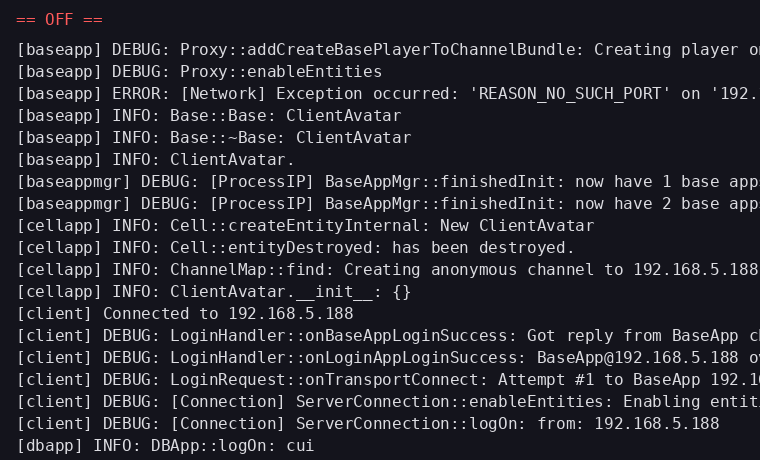

### baseapp

only when **off**:

```
DEBUG: Proxy::addCreateBasePlayerToChannelBundle: Creating player on client
DEBUG: Proxy::enableEntities
ERROR: [Network] Exception occurred: 'REASON_NO_SUCH_PORT' on '192.168.5.188'
INFO: Base::Base: ClientAvatar
INFO: Base::~Base: ClientAvatar
INFO: ClientAvatar.
INFO: ClientAvatar.__init__: {'prop1': 1} 0
INFO: IDClient::retrieveIDsFromStream: Received from 1 to
INFO: LoginHandler:: from 192.168.5.188. Attempt 1
TRACE: BaseApp: at udp:192.168.5.188
TRACE: BaseApp::removeProxy: Removing proxy id addr udp:192.168.5.188
TRACE: Proxy::onClientDeath: Client id has disconnected (Requested by client)
```

### baseappmgr

only when **off**:

```
DEBUG: [ProcessIP] BaseAppMgr::finishedInit: now have 1 base apps and 0 service apps ready
DEBUG: [ProcessIP] BaseAppMgr::finishedInit: now have 2 base apps and 0 service apps ready
```

only when **on**:

```
DEBUG: [ProcessIP] BaseAppMgr::finishedInit: now have 0 base apps and 1 service apps ready
DEBUG: [ProcessIP] BaseAppMgr::finishedInit: now have 1 base apps and 1 service apps ready
INFO: [ProcessIP] BaseAppMgr::add: Not allowing BaseApp at 192.168.5.188 to register yet (No init data from DBApp Alpha)
```

### cellapp

only when **off**:

```
INFO: Cell::createEntityInternal: New ClientAvatar
INFO: Cell::entityDestroyed: has been destroyed.
INFO: ChannelMap::find: Creating anonymous channel to 192.168.5.188
INFO: ClientAvatar.__init__: {}
```

### client

only when **off**:

```
Connected to 192.168.5.188
DEBUG: LoginHandler::onBaseAppLoginSuccess: Got reply from BaseApp channel udp:192.168.5.188
DEBUG: LoginHandler::onLoginAppLoginSuccess: BaseApp@192.168.5.188 over UDP (# requests: 10, retry interval:1.0s, timeout interval: 8.0s)
DEBUG: LoginRequest::onTransportConnect: Attempt #1 to BaseApp 192.168.5.188; took 0.0s, time left = 8.0s
DEBUG: [Connection] ServerConnection::enableEntities: Enabling entities
DEBUG: [Connection] ServerConnection::logOn: from: 192.168.5.188
DEBUG: [Connection] ServerConnection::logOn: status==LOGGED_ON
DEBUG: [Connection] ServerConnection::logOn: to: 192.168.5.188
TRACE: LoginHandler::sendNextRequest: From 192.168.5.188, attempt #1 / 10 to BaseApp 192.168.5.188
TRACE: LoginRequest::handleMessage: Attempt #1: Received reply from 192.168.5.188 (after 0.1s)
TRACE: LoginRequest::handleMessage: Attempt #1: Received reply from 192.168.5.188 (after 0.2s)
```

only when **on**:

```
INFO: LoginAppLoginRequestProtocol::onReply: Attempt #1: Server rejected our login. Reject status: 74, reject data (optional): Server not ready.
INFO: [Connection] ServerConnection::logOnComplete: Logon failed: Server not ready.
Login failed: Server not ready.
TRACE: LoginRequest::handleMessage: Attempt #1: Received reply from 192.168.5.188 (after 0.7s)
WARNING: LoginHandler::fail: status = 74, errorMessage = "Server not ready."
```

### dbapp

only when **off**:

```
INFO: DBApp::logOn: cui
```

only when **on**:

```
INFO: DBApp::logOn: Login failed for cui. Server not ready.
WARNING: [Network] PacketReceiver::handleInputNotification: last received from 192.168.5.188, stopping socket processing after .480ms (processed 1 packets), receive queue at 960 bytesINFO: ChannelMap::find: Creating anonymous channel to 192.168.5.188
```

### loginapp

only when **off**:

```
INFO: [Config] loginApp/registerExternalInterface = false
```

only when **on**:

```
INFO: [Config] loginApp/registerExternalInterface = true (default: false)
INFO: [Network] LoginApp::handleFailure: LogOn for 192.168.5.188 failed, LogOnStatus: 74, description 'Server not ready.'.
```

### serviceapp

only when **off**:

```
INFO: IDClient::retrieveIDsFromStream: Received from to
```

only when **on**:

```
INFO: IDClient::retrieveIDsFromStream: Received from 1 to
```


## LoginAppConfig.shouldOffsetExternalPortByUID

xml `loginApp/shouldOffsetExternalPortByUID`, default `false` (captured 2026-11-23T03:28:41)

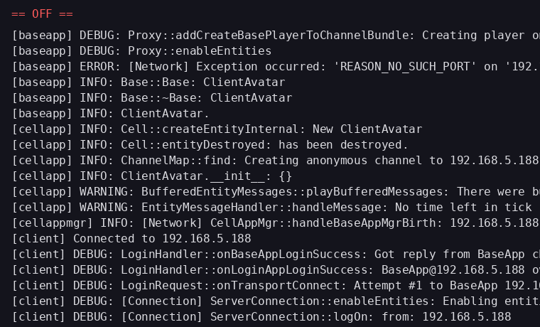

### baseapp

only when **off**:

```
DEBUG: Proxy::addCreateBasePlayerToChannelBundle: Creating player on client
DEBUG: Proxy::enableEntities
ERROR: [Network] Exception occurred: 'REASON_NO_SUCH_PORT' on '192.168.5.188'
INFO: Base::Base: ClientAvatar
INFO: Base::~Base: ClientAvatar
INFO: ClientAvatar.
INFO: ClientAvatar.__init__: {'prop1': 1} 0
INFO: LoginHandler:: from 192.168.5.188. Attempt 1
TRACE: BaseApp: at udp:192.168.5.188
TRACE: BaseApp::removeProxy: Removing proxy id 1 addr udp:192.168.5.188
TRACE: Proxy::onClientDeath: Client id 1 has disconnected (Requested by client)
```

only when **on**:

```
WARNING: BaseApp::handleTimeout: Last tick quantum took 534% of allocation (0.53 seconds)! Proxy clients may have been starved!
WARNING: BaseApp::handleTimeout: Last tick quantum took 635% of allocation (0.63 seconds)! Proxy clients may have been starved!
WARNING: [Server] ServerApp::onTickPeriod: Last game tick . Expected 0.10.
```

### baseappmgr

only when **on**:

```
WARNING: [Server] ServerApp::onTickPeriod: Last game tick . Expected 0.10.
```

### cellapp

only when **off**:

```
INFO: Cell::createEntityInternal: New ClientAvatar
INFO: Cell::entityDestroyed: has been destroyed.
INFO: ChannelMap::find: Creating anonymous channel to 192.168.5.188
INFO: ClientAvatar.__init__: {}
WARNING: BufferedEntityMessages::playBufferedMessages: There were buffered messages. Played 1 of 1
WARNING: EntityMessageHandler::handleMessage: No time left in tick . Buffering 'createEntityNearEntity' and similar messages this tick. Num previously in buffer = 0.
```

### cellappmgr

only when **off**:

```
INFO: [Network] CellAppMgr::handleBaseAppMgrBirth: 192.168.5.188
```

only when **on**:

```
WARNING: [Server] ServerApp::onTickPeriod: Last game tick . Expected 0.10.
```

### client

only when **off**:

```
Connected to 192.168.5.188
DEBUG: LoginHandler::onBaseAppLoginSuccess: Got reply from BaseApp channel udp:192.168.5.188
DEBUG: LoginHandler::onLoginAppLoginSuccess: BaseApp@192.168.5.188 over UDP (# requests: 10, retry interval:1.0s, timeout interval: 8.0s)
DEBUG: LoginRequest::onTransportConnect: Attempt #1 to BaseApp 192.168.5.188; took 0.0s, time left = 8.0s
DEBUG: [Connection] ServerConnection::enableEntities: Enabling entities
DEBUG: [Connection] ServerConnection::logOn: from: 192.168.5.188
DEBUG: [Connection] ServerConnection::logOn: status==LOGGED_ON
DEBUG: [Connection] ServerConnection::logOn: to: 192.168.5.188
TRACE: LoginHandler::sendNextRequest: From 192.168.5.188, attempt #1 / 10 to BaseApp 192.168.5.188
TRACE: LoginRequest::handleMessage: Attempt #1: Received reply from 192.168.5.188 (after 0.1s)
```

only when **on**:

```
DEBUG: LoginRequest::onTransportConnect: Attempt #10 to LoginApp 192.168.5.188; took 0.0s, time left = 8.0s
DEBUG: LoginRequest::onTransportConnect: Attempt #2 to LoginApp 192.168.5.188; took 0.0s, time left = 8.0s
DEBUG: LoginRequest::onTransportConnect: Attempt #3 to LoginApp 192.168.5.188; took 0.0s, time left = 8.0s
DEBUG: LoginRequest::onTransportConnect: Attempt #4 to LoginApp 192.168.5.188; took 0.0s, time left = 8.0s
DEBUG: LoginRequest::onTransportConnect: Attempt #5 to LoginApp 192.168.5.188; took 0.0s, time left = 8.0s
DEBUG: LoginRequest::onTransportConnect: Attempt #6 to LoginApp 192.168.5.188; took 0.0s, time left = 8.0s
DEBUG: LoginRequest::onTransportConnect: Attempt #7 to LoginApp 192.168.5.188; took 0.0s, time left = 8.0s
DEBUG: LoginRequest::onTransportConnect: Attempt #8 to LoginApp 192.168.5.188; took 0.0s, time left = 8.0s
DEBUG: LoginRequest::onTransportConnect: Attempt #9 to LoginApp 192.168.5.188; took 0.0s, time left = 8.0s
TRACE: LoginHandler::sendNextRequest: From 192.168.5.188, attempt #10 / 10 to LoginApp 192.168.5.188
TRACE: LoginHandler::sendNextRequest: From 192.168.5.188, attempt #2 / 10 to LoginApp 192.168.5.188
TRACE: LoginHandler::sendNextRequest: From 192.168.5.188, attempt #3 / 10 to LoginApp 192.168.5.188
```

### dbapp

only when **off**:

```
INFO: DBApp::logOn: cui
WARNING: [Network] PacketReceiver::handleInputNotification: last received from 192.168.5.188, stopping socket processing after .206ms (processed 1 packets), receive queue at 0 bytesINFO: ChannelMap::find: Creating anonymous channel to 192.168.5.188
```

only when **on**:

```
WARNING: [Network] PacketReceiver::handleInputNotification: last received from 192.168.5.188, stopping socket processing after .587ms (processed 1 packets), receive queue at 0 bytesINFO: ChannelMap::find: Creating anonymous channel to 192.168.5.188
WARNING: [Server] ServerApp::onTickPeriod: Last game tick . Expected 0.10.
```

### dbappmgr

only when **on**:

```
WARNING: [Server] ServerApp::onTickPeriod: Last game tick . Expected 0.10.
```

### loginapp

only when **off**:

```
INFO: LoginApp::login: Attempt from 192.168.5.188
INFO: LoginApp::login: Logging in user 'cui' (192.168.5.188)
INFO: [Config] loginApp/shouldOffsetExternalPortByUID = false
```

only when **on**:

```
INFO: [Config] loginApp/shouldOffsetExternalPortByUID = true (default: false)
WARNING: [Server] ServerApp::onTickPeriod: Last game tick . Expected 0.10.
```

### serviceapp

only when **on**:

```
WARNING: BaseApp::handleTimeout: Last tick quantum took 703% of allocation (0.70 seconds)! Proxy clients may have been starved!
WARNING: [Server] ServerApp::onTickPeriod: Last game tick . Expected 0.10.
```


## LoginAppConfig.shouldShutDownIfPortUsed

xml `loginApp/shouldShutDownIfPortUsed`, default `true` (captured 2026-11-23T03:32:23)

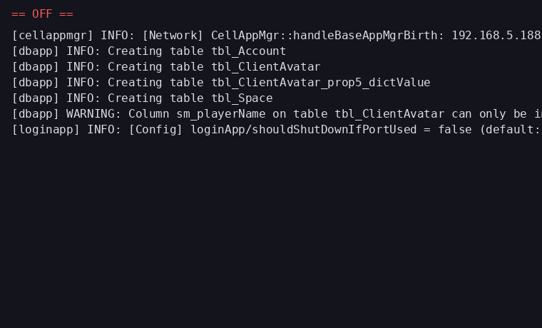

### cellappmgr

only when **off**:

```
INFO: [Network] CellAppMgr::handleBaseAppMgrBirth: 192.168.5.188
```

### client

only when **on**:

```
DEBUG: LoginRequest::onTransportConnect: Attempt #10 to LoginApp 192.168.5.188; took 0.0s, time left = 8.0s
DEBUG: LoginRequest::onTransportConnect: Attempt #6 to LoginApp 192.168.5.188; took 0.0s, time left = 8.0s
DEBUG: LoginRequest::onTransportConnect: Attempt #7 to LoginApp 192.168.5.188; took 0.0s, time left = 8.0s
DEBUG: LoginRequest::onTransportConnect: Attempt #8 to LoginApp 192.168.5.188; took 0.0s, time left = 8.0s
DEBUG: LoginRequest::onTransportConnect: Attempt #9 to LoginApp 192.168.5.188; took 0.0s, time left = 8.0s
TRACE: LoginHandler::sendNextRequest: From 192.168.5.188, attempt #10 / 10 to LoginApp 192.168.5.188
TRACE: LoginHandler::sendNextRequest: From 192.168.5.188, attempt #6 / 10 to LoginApp 192.168.5.188
TRACE: LoginHandler::sendNextRequest: From 192.168.5.188, attempt #7 / 10 to LoginApp 192.168.5.188
TRACE: LoginHandler::sendNextRequest: From 192.168.5.188, attempt #8 / 10 to LoginApp 192.168.5.188
TRACE: LoginHandler::sendNextRequest: From 192.168.5.188, attempt #9 / 10 to LoginApp 192.168.5.188
TRACE: LoginRequest::handleException: Attempt #1: (no channel): REASON_TIMER_EXPIRED (time since start = 8.0s)
TRACE: LoginRequest::handleException: Attempt #2: (no channel): REASON_TIMER_EXPIRED (time since start = 8.4s)
```

### dbapp

only when **off**:

```
INFO: Creating table tbl_Account
INFO: Creating table tbl_ClientAvatar
INFO: Creating table tbl_ClientAvatar_prop5_dictValue
INFO: Creating table tbl_Space
WARNING: Column sm_playerName on table tbl_ClientAvatar can only be indexed up to the first 255 characters (column is of length ).
```

### loginapp

only when **off**:

```
INFO: [Config] loginApp/shouldShutDownIfPortUsed = false (default: true)
```

only when **on**:

```
INFO: [Config] loginApp/shouldShutDownIfPortUsed = true
```


## LoginAppConfig.verboseExternalInterface

xml `loginApp/verboseExternalInterface`, default `false` (captured 2026-11-23T03:36:35)

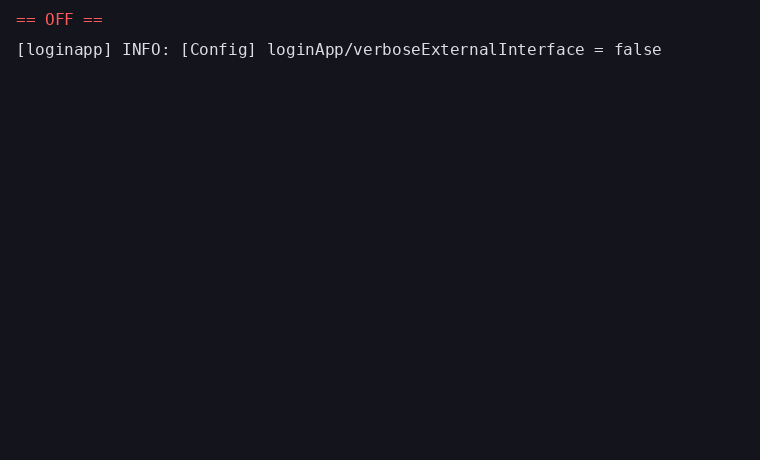

### client

only when **on**:

```
DEBUG: LoginRequest::onTransportConnect: Attempt #10 to LoginApp 192.168.5.188; took 0.0s, time left = 8.0s
DEBUG: LoginRequest::onTransportConnect: Attempt #7 to LoginApp 192.168.5.188; took 0.0s, time left = 8.0s
DEBUG: LoginRequest::onTransportConnect: Attempt #8 to LoginApp 192.168.5.188; took 0.0s, time left = 8.0s
DEBUG: LoginRequest::onTransportConnect: Attempt #9 to LoginApp 192.168.5.188; took 0.0s, time left = 8.0s
TRACE: LoginHandler::sendNextRequest: From 192.168.5.188, attempt #10 / 10 to LoginApp 192.168.5.188
TRACE: LoginHandler::sendNextRequest: From 192.168.5.188, attempt #7 / 10 to LoginApp 192.168.5.188
TRACE: LoginHandler::sendNextRequest: From 192.168.5.188, attempt #8 / 10 to LoginApp 192.168.5.188
TRACE: LoginHandler::sendNextRequest: From 192.168.5.188, attempt #9 / 10 to LoginApp 192.168.5.188
TRACE: LoginRequest::handleException: Attempt #1: (no channel): REASON_TIMER_EXPIRED (time since start = 8.0s)
TRACE: LoginRequest::handleException: Attempt #2: (no channel): REASON_TIMER_EXPIRED (time since start = 8.0s)
TRACE: LoginRequest::handleException: Attempt #3: (no channel): REASON_TIMER_EXPIRED (time since start = 8.8s)
TRACE: LoginRequest::handleException: Attempt #4: (no channel): REASON_TIMER_EXPIRED (time since start = 8.2s)
```

### dbapp

only when **on**:

```
INFO: Creating table tbl_Account
```

### loginapp

only when **off**:

```
INFO: [Config] loginApp/verboseExternalInterface = false
```

only when **on**:

```
INFO: [Config] loginApp/verboseExternalInterface = true (default: false)
```


## LoginAppConfig.verboseLoginFailures

xml `loginApp/verboseLoginFailures`, default `false` (captured 2026-11-23T04:49:50)

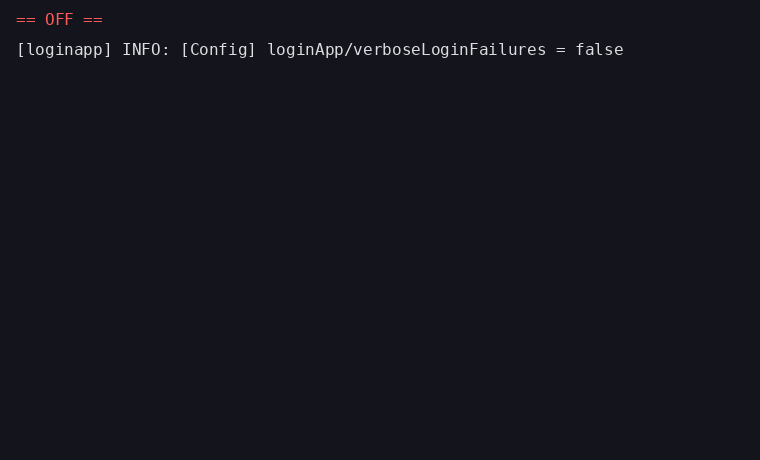

### loginapp

only when **off**:

```
INFO: [Config] loginApp/verboseLoginFailures = false
```

only when **on**:

```
INFO: [Config] loginApp/verboseLoginFailures = true (default: false)
```


## ManagerAppConfig.isBadStateWithNoServiceApps

xml `isBadStateWithNoServiceApps`, default `false` (captured 2026-11-23T04:51:31)

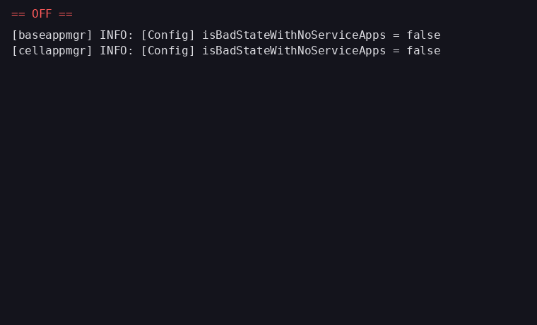

### baseappmgr

only when **off**:

```
INFO: [Config] isBadStateWithNoServiceApps = false
```

only when **on**:

```
INFO: [Config] isBadStateWithNoServiceApps = true (default: false)
```

### cellappmgr

only when **off**:

```
INFO: [Config] isBadStateWithNoServiceApps = false
```

only when **on**:

```
INFO: [Config] isBadStateWithNoServiceApps = true (default: false)
```


## ManagerAppConfig.shutDownServerOnBadState

xml `shutDownServerOnBadState`, default `true` (captured 2026-11-23T04:53:11)

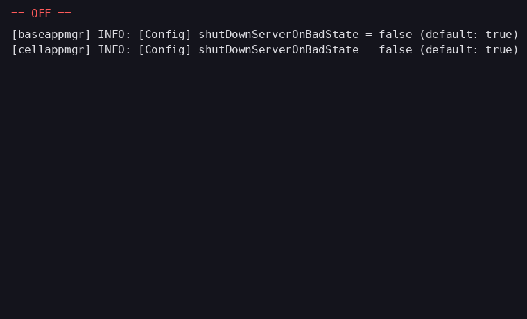

### baseappmgr

only when **off**:

```
INFO: [Config] shutDownServerOnBadState = false (default: true)
```

only when **on**:

```
INFO: [Config] shutDownServerOnBadState = true
```

### cellappmgr

only when **off**:

```
INFO: [Config] shutDownServerOnBadState = false (default: true)
```

only when **on**:

```
INFO: [Config] shutDownServerOnBadState = true
```


## ManagerAppConfig.shutDownServerOnBaseAppDeath

xml `shutDownServerOnBaseAppDeath`, default `false` (captured 2026-11-23T04:54:50)

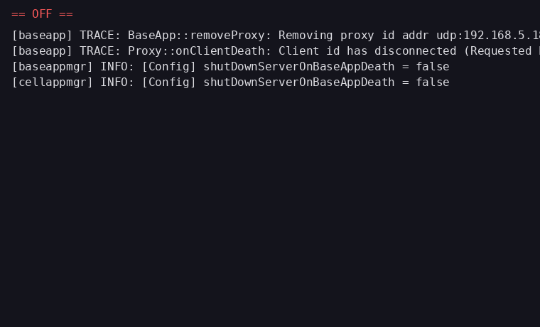

### baseapp

only when **off**:

```
TRACE: BaseApp::removeProxy: Removing proxy id addr udp:192.168.5.188
TRACE: Proxy::onClientDeath: Client id has disconnected (Requested by client)
```

only when **on**:

```
TRACE: BaseApp::removeProxy: Removing proxy id 2 addr udp:192.168.5.188
TRACE: Proxy::onClientDeath: Client id 2 has disconnected (Requested by client)
```

### baseappmgr

only when **off**:

```
INFO: [Config] shutDownServerOnBaseAppDeath = false
```

only when **on**:

```
INFO: [Config] shutDownServerOnBaseAppDeath = true (default: false)
```

### cellappmgr

only when **off**:

```
INFO: [Config] shutDownServerOnBaseAppDeath = false
```

only when **on**:

```
INFO: [Config] shutDownServerOnBaseAppDeath = true (default: false)
```


## ManagerAppConfig.shutDownServerOnCellAppDeath

xml `shutDownServerOnCellAppDeath`, default `false` (captured 2026-11-23T04:56:29)

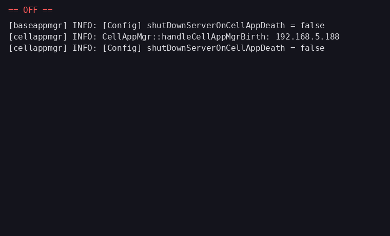

### baseappmgr

only when **off**:

```
INFO: [Config] shutDownServerOnCellAppDeath = false
```

only when **on**:

```
INFO: [Config] shutDownServerOnCellAppDeath = true (default: false)
```

### cellappmgr

only when **off**:

```
INFO: CellAppMgr::handleCellAppMgrBirth: 192.168.5.188
INFO: [Config] shutDownServerOnCellAppDeath = false
```

only when **on**:

```
INFO: [Config] shutDownServerOnCellAppDeath = true (default: false)
```


## ManagerAppConfig.shutDownServerOnServiceAppDeath

xml `shutDownServerOnServiceAppDeath`, default `false` (captured 2026-11-23T04:58:05)

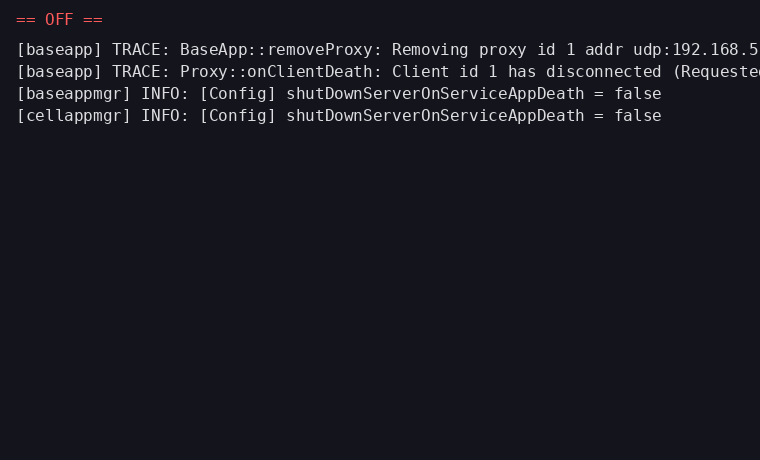

### baseapp

only when **off**:

```
TRACE: BaseApp::removeProxy: Removing proxy id 1 addr udp:192.168.5.188
TRACE: Proxy::onClientDeath: Client id 1 has disconnected (Requested by client)
```

only when **on**:

```
TRACE: BaseApp::removeProxy: Removing proxy id addr udp:192.168.5.188
TRACE: Proxy::onClientDeath: Client id has disconnected (Requested by client)
```

### baseappmgr

only when **off**:

```
INFO: [Config] shutDownServerOnServiceAppDeath = false
```

only when **on**:

```
INFO: [Config] shutDownServerOnServiceAppDeath = true (default: false)
```

### cellappmgr

only when **off**:

```
INFO: [Config] shutDownServerOnServiceAppDeath = false
```

only when **on**:

```
INFO: CellAppMgr::handleCellAppMgrBirth: 192.168.5.188
INFO: [Config] shutDownServerOnServiceAppDeath = true (default: false)
INFO: [Network] CellAppMgr::handleBaseAppMgrBirth: 192.168.5.188
```


## ManagerAppConfig.shutDownServerOnServiceDeath

xml `shutDownServerOnServiceDeath`, default `false` (captured 2026-11-23T04:59:44)

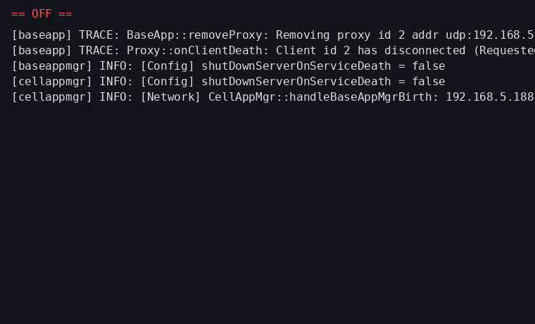

### baseapp

only when **off**:

```
TRACE: BaseApp::removeProxy: Removing proxy id 2 addr udp:192.168.5.188
TRACE: Proxy::onClientDeath: Client id 2 has disconnected (Requested by client)
```

only when **on**:

```
TRACE: BaseApp::removeProxy: Removing proxy id addr udp:192.168.5.188
TRACE: Proxy::onClientDeath: Client id has disconnected (Requested by client)
```

### baseappmgr

only when **off**:

```
INFO: [Config] shutDownServerOnServiceDeath = false
```

only when **on**:

```
INFO: [Config] shutDownServerOnServiceDeath = true (default: false)
```

### cellappmgr

only when **off**:

```
INFO: [Config] shutDownServerOnServiceDeath = false
INFO: [Network] CellAppMgr::handleBaseAppMgrBirth: 192.168.5.188
```

only when **on**:

```
INFO: [Config] shutDownServerOnServiceDeath = true (default: false)
```


## ReviverConfig.shutDownOnRevive

xml `reviver/shutDownOnRevive`, default `true` (captured 2026-11-23T05:01:21)


### baseapp

only when **off**:

```
TRACE: BaseApp::removeProxy: Removing proxy id addr udp:192.168.5.188
TRACE: Proxy::onClientDeath: Client id has disconnected (Requested by client)
```

only when **on**:

```
TRACE: BaseApp::removeProxy: Removing proxy id 1 addr udp:192.168.5.188
TRACE: Proxy::onClientDeath: Client id 1 has disconnected (Requested by client)
```


## ServerAppConfig.allowInteractiveDebugging

xml `allowInteractiveDebugging`, default `(getter)` (captured 2026-11-23T05:03:00)

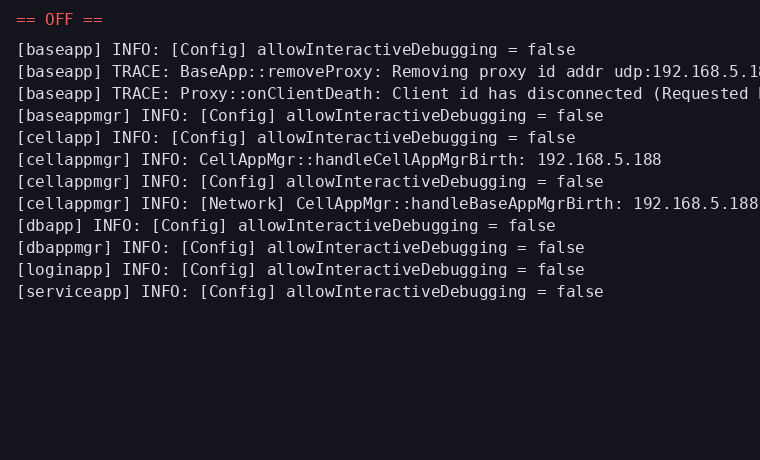

### baseapp

only when **off**:

```
INFO: [Config] allowInteractiveDebugging = false
TRACE: BaseApp::removeProxy: Removing proxy id addr udp:192.168.5.188
TRACE: Proxy::onClientDeath: Client id has disconnected (Requested by client)
```

only when **on**:

```
INFO: [Config] allowInteractiveDebugging = true (default: false)
TRACE: BaseApp::removeProxy: Removing proxy id 2 addr udp:192.168.5.188
TRACE: Proxy::onClientDeath: Client id 2 has disconnected (Requested by client)
```

### baseappmgr

only when **off**:

```
INFO: [Config] allowInteractiveDebugging = false
```

only when **on**:

```
INFO: [Config] allowInteractiveDebugging = true (default: false)
```

### cellapp

only when **off**:

```
INFO: [Config] allowInteractiveDebugging = false
```

only when **on**:

```
INFO: [Config] allowInteractiveDebugging = true (default: false)
WARNING: BufferedEntityMessages::playBufferedMessages: There were buffered messages. Played 1 of 1
WARNING: EntityMessageHandler::handleMessage: No time left in tick . Buffering 'createEntityNearEntity' and similar messages this tick. Num previously in buffer = 0.
```

### cellappmgr

only when **off**:

```
INFO: CellAppMgr::handleCellAppMgrBirth: 192.168.5.188
INFO: [Config] allowInteractiveDebugging = false
INFO: [Network] CellAppMgr::handleBaseAppMgrBirth: 192.168.5.188
```

only when **on**:

```
INFO: [Config] allowInteractiveDebugging = true (default: false)
```

### dbapp

only when **off**:

```
INFO: [Config] allowInteractiveDebugging = false
```

only when **on**:

```
INFO: [Config] allowInteractiveDebugging = true (default: false)
```

### dbappmgr

only when **off**:

```
INFO: [Config] allowInteractiveDebugging = false
```

only when **on**:

```
INFO: [Config] allowInteractiveDebugging = true (default: false)
```

### loginapp

only when **off**:

```
INFO: [Config] allowInteractiveDebugging = false
```

only when **on**:

```
INFO: [Config] allowInteractiveDebugging = true (default: false)
```

### serviceapp

only when **off**:

```
INFO: [Config] allowInteractiveDebugging = false
```

only when **on**:

```
INFO: [Config] allowInteractiveDebugging = true (default: false)
```


## ServerAppConfig.hasHitchDetection

xml `hitchDetection/enabled`, default `false` (captured 2026-11-23T05:04:38)

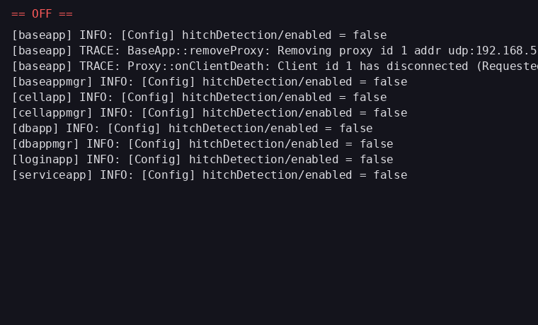

### baseapp

only when **off**:

```
INFO: [Config] hitchDetection/enabled = false
TRACE: BaseApp::removeProxy: Removing proxy id 1 addr udp:192.168.5.188
TRACE: Proxy::onClientDeath: Client id 1 has disconnected (Requested by client)
```

only when **on**:

```
INFO: [Config] hitchDetection/enabled = true (default: false)
TRACE: BaseApp::removeProxy: Removing proxy id addr udp:192.168.5.188
TRACE: Proxy::onClientDeath: Client id has disconnected (Requested by client)
```

### baseappmgr

only when **off**:

```
INFO: [Config] hitchDetection/enabled = false
```

only when **on**:

```
INFO: [Config] hitchDetection/enabled = true (default: false)
```

### cellapp

only when **off**:

```
INFO: [Config] hitchDetection/enabled = false
```

only when **on**:

```
INFO: [Config] hitchDetection/enabled = true (default: false)
```

### cellappmgr

only when **off**:

```
INFO: [Config] hitchDetection/enabled = false
```

only when **on**:

```
INFO: [Config] hitchDetection/enabled = true (default: false)
```

### client

only when **on**:

```
TRACE: LoginRequest::handleMessage: Attempt #1: Received reply from 192.168.5.188 (after 0.2s)
```

### dbapp

only when **off**:

```
INFO: [Config] hitchDetection/enabled = false
```

only when **on**:

```
INFO: [Config] hitchDetection/enabled = true (default: false)
```

### dbappmgr

only when **off**:

```
INFO: [Config] hitchDetection/enabled = false
```

only when **on**:

```
INFO: [Config] hitchDetection/enabled = true (default: false)
```

### loginapp

only when **off**:

```
INFO: [Config] hitchDetection/enabled = false
```

only when **on**:

```
INFO: [Config] hitchDetection/enabled = true (default: false)
```

### serviceapp

only when **off**:

```
INFO: [Config] hitchDetection/enabled = false
```

only when **on**:

```
INFO: [Config] hitchDetection/enabled = true (default: false)
```


## ServerAppConfig.isProduction

xml `production`, default `true` (captured 2026-11-23T05:06:16)

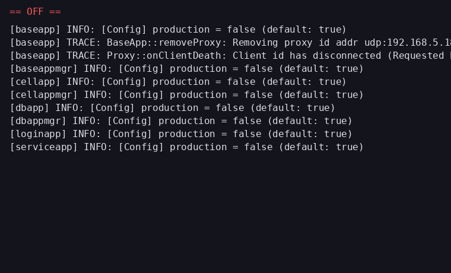

### baseapp

only when **off**:

```
INFO: [Config] production = false (default: true)
TRACE: BaseApp::removeProxy: Removing proxy id addr udp:192.168.5.188
TRACE: Proxy::onClientDeath: Client id has disconnected (Requested by client)
```

only when **on**:

```
INFO: [Config] production = true
TRACE: BaseApp::removeProxy: Removing proxy id 1 addr udp:192.168.5.188
TRACE: Proxy::onClientDeath: Client id 1 has disconnected (Requested by client)
```

### baseappmgr

only when **off**:

```
INFO: [Config] production = false (default: true)
```

only when **on**:

```
INFO: [Config] production = true
```

### cellapp

only when **off**:

```
INFO: [Config] production = false (default: true)
```

only when **on**:

```
INFO: Production Mode: Treating other entities as ghosts enabled. This may reduce your performance.
INFO: [Config] production = true
```

### cellappmgr

only when **off**:

```
INFO: [Config] production = false (default: true)
```

only when **on**:

```
INFO: [Config] production = true
INFO: [Network] CellAppMgr::handleBaseAppMgrBirth: 192.168.5.188
```

### dbapp

only when **off**:

```
INFO: [Config] production = false (default: true)
```

only when **on**:

```
INFO: [Config] production = true
```

### dbappmgr

only when **off**:

```
INFO: [Config] production = false (default: true)
```

only when **on**:

```
INFO: [Config] production = true
```

### loginapp

only when **off**:

```
INFO: [Config] production = false (default: true)
```

only when **on**:

```
INFO: [Config] production = true
```

### serviceapp

only when **off**:

```
INFO: [Config] production = false (default: true)
```

only when **on**:

```
INFO: [Config] production = true
```


## ServerAppConfig.useDefaultSpace

xml `useDefaultSpace`, default `false` (captured 2026-11-23T05:07:52)

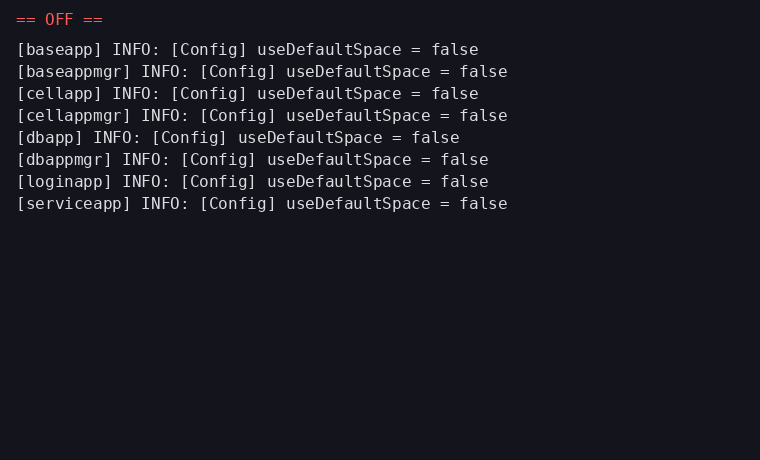

### baseapp

only when **off**:

```
INFO: [Config] useDefaultSpace = false
```

only when **on**:

```
INFO: [Config] useDefaultSpace = true (default: false)
```

### baseappmgr

only when **off**:

```
INFO: [Config] useDefaultSpace = false
```

only when **on**:

```
INFO: [Config] useDefaultSpace = true (default: false)
```

### cellapp

only when **off**:

```
INFO: [Config] useDefaultSpace = false
```

only when **on**:

```
INFO: CellApp::addCell: Space = 1
INFO: [Config] useDefaultSpace = true (default: false)
```

### cellappmgr

only when **off**:

```
INFO: [Config] useDefaultSpace = false
```

only when **on**:

```
INFO: CellAppMgr::findSpace: Creating default space.
INFO: CellAppMgr::handleCellAppMgrBirth: 192.168.5.188
INFO: Space::addCell: Space 1. CellApp 1 (192.168.5.188)
INFO: [Config] useDefaultSpace = true (default: false)
```

### client

only when **on**:

```
TRACE: LoginRequest::handleMessage: Attempt #1: Received reply from 192.168.5.188 (after 0.2s)
```

### dbapp

only when **off**:

```
INFO: [Config] useDefaultSpace = false
```

only when **on**:

```
INFO: [Config] useDefaultSpace = true (default: false)
```

### dbappmgr

only when **off**:

```
INFO: [Config] useDefaultSpace = false
```

only when **on**:

```
INFO: [Config] useDefaultSpace = true (default: false)
```

### loginapp

only when **off**:

```
INFO: [Config] useDefaultSpace = false
```

only when **on**:

```
INFO: [Config] useDefaultSpace = true (default: false)
```

### serviceapp

only when **off**:

```
INFO: [Config] useDefaultSpace = false
```

only when **on**:

```
INFO: [Config] useDefaultSpace = true (default: false)
```

